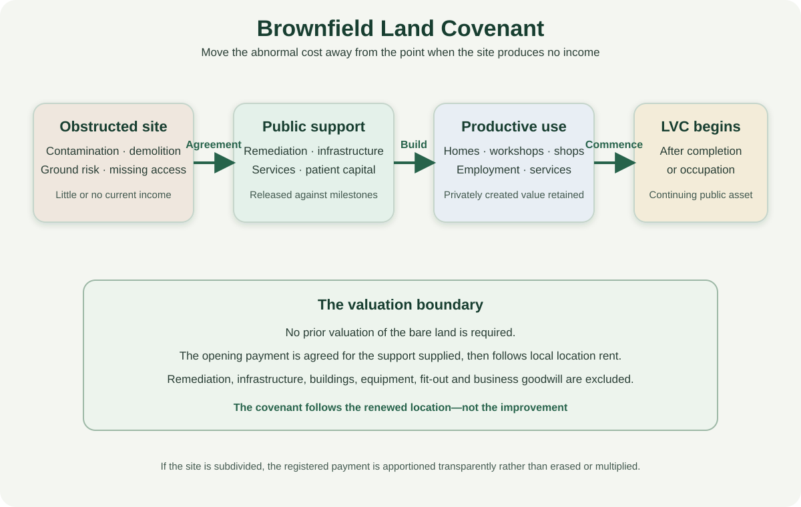

## Basic concept {#basic-concept}

Brownfield land may be well located but remain unused because demolition, contamination, unstable ground, obsolete structures, fragmented ownership or missing infrastructure makes redevelopment uneconomic. The site can possess substantial future potential while producing little or no present income from which those abnormal costs can be paid.

The Brownfield Land Covenant would allow the owner or developer to receive an agreed package of remediation, infrastructure, site assembly, professional services or long-term capital from a public LVC fund. In exchange, a continuing Location Value Covenant would be registered against the site.

The transaction would be voluntary. The owner would decide whether the support supplied is worth accepting the covenant. Government would acquire a continuing property-linked revenue asset rather than making a grant that disappears once the works are complete.

The covenant would not give government a claim over the buildings or businesses subsequently created. It would follow changes in the economic value of the location while excluding value produced by demolition, decontamination, construction, equipment, fit-out and private enterprise.

Possible support could include:

| Brownfield obstacle | What the public fund could supply |
| --- | --- |
| Contamination or dangerous structures | Investigation, remediation, demolition and certification |
| Unstable, flooded or inaccessible land | Ground works, drainage, flood protection and access |
| Missing services | Connections to transport, energy, water, sewerage and digital infrastructure |
| Fragmented or complicated site | Land assembly, legal work and coordinated master-planning |
| High early cost and delayed receipts | Patient development capital or refinancing |
| Marginal scheme viability | A combined package sufficient to make construction proceed |

### No prior land valuation

The agreement would not begin by estimating what the bare land was worth before the covenant. On a damaged or obsolete site, that exercise could be particularly artificial: liability, remediation costs, planning uncertainty and alternative uses can produce radically different residual figures.

Instead, the parties would identify what the public fund will supply and agree the opening covenant payment, commencement date and indexation that make the exchange acceptable. Government would assess the covenant it receives—not attempt to discover a separate pre-covenant land value.

Once the site is brought into use, the payment could follow a published index of comparable local location rents. The index would reflect the changing value of access, surrounding services, permitted use and neighbourhood demand. It would not increase because the owner built more, remediated better or attracted a successful occupier.

This is a policy proposal, not a currently available finance, planning or remediation scheme. Detailed environmental, legal, planning, lending and procurement rules would be required.

## Worked example {#worked-example}

Assume a former industrial site could accommodate 80 homes, workshops and small commercial units, but requires £3 million of demolition, contamination treatment, drainage, access and utility works before construction can begin.

Conventional finance may regard the preliminary risk as too high or charge enough to make the scheme unviable. The local authority may want the site restored but cannot justify an unrecoverable £3 million grant.

Under a Brownfield Land Covenant:

1. The public LVC fund agrees to procure or finance the £3 million enabling package.
2. The owner grants a covenant with no payment during an agreed remediation and construction period.
3. The covenant begins when the completed property is occupied or after a fixed longstop date.
4. Its illustrative opening payment is agreed at £120,000 a year and subsequently follows the local location-rent index.
5. The developer privately finances the homes and commercial buildings and retains their full value.

| Illustrative position | Without the covenant | With the covenant |
| --- | ---: | ---: |
| Abnormal enabling costs requiring finance | £3,000,000 | Supplied by the public LVC fund |
| LVC during approved remediation and construction | None | None |
| Initial annual LVC after commencement | None | £120,000 |
| Public asset after the initial works | None if funded by grant | Continuing indexed covenant |
| Value of new buildings captured by the LVC | None | None |

The £120,000 is illustrative rather than a prescribed percentage. The complete payment stream would have to justify the public contribution after funding costs, delay, administration, risk and expected indexation were considered.

The covenant does not add £120,000 to the rents obtainable from residents or businesses. Occupiers already pay what competition for available premises allows. The obligation falls on the owner's economic interest and is reflected in the capital value of the covenanted site. The new homes and premises expand supply and can relieve pressure elsewhere.

## How the LVC works {#how-it-works}

### The voluntary agreement

1. The owner, developer or local authority identifies the obstacles preventing a defined brownfield site from returning to use.
2. Independent investigation establishes the required works, risks, responsibilities and realistic delivery milestones.
3. The public fund specifies the capital, works, infrastructure or services it is prepared to supply.
4. The parties negotiate the opening LVC payment, commencement event, indexation and delivery obligations without first valuing the bare land.
5. The covenant and development agreement are registered before public resources are committed.
6. Support is released in stages as remediation, construction and occupation milestones are achieved.
7. Once commenced, the LVC remains attached when the site or completed interests are sold.

### Construction and commencement period

A derelict site cannot fund a large payment from income it does not yet produce. The LVC should therefore be nil or nominal during approved remediation and construction. Payment would begin at an objectively defined event such as practical completion, first occupation, a specified occupancy threshold or a longstop date.

The agreement must prevent indefinite delay. Milestones could permit the public fund to suspend support, recover specified costs, appoint replacement contractors, acquire a defined interest or commence the payment if the owner fails to proceed without an accepted reason.

### Protecting remediation and improvements

The valuation boundary is essential. The LVC may follow the economic rent arising from the location and its lawful use, but it must exclude value attributable to:

* Demolition, clearance and contamination treatment;
* Ground stabilisation, drainage and flood-resilience works;
* Privately financed roads, utilities and site infrastructure;
* Homes, factories, shops, offices and other buildings;
* Repairs, maintenance and subsequent improvements;
* Machinery, equipment and occupier fit-out;
* Environmental improvements financed by the owner or occupier; and
* The income, productivity and goodwill of businesses operating on the site.

The covenant must not rise merely because the developer builds well, the owner maintains the property or an occupier becomes productive. Otherwise it would recreate the penalty on investment that the policy is intended to remove.

### Indexation after development

The opening payment is part of the negotiated exchange. Later changes would follow an independently maintained local location-rent index appropriate to the completed lawful use. Actual rents from the individual development should not be used mechanically because they also reflect its buildings, specification, management and commercial success.

If planning permission later changes the lawful use materially, published rules could move the covenant to an appropriate index. The change would reflect the new locational opportunity created by the permission—not the cost or quality of buildings constructed to use it.

### Subdivision, sale and redevelopment

Where the completed site is divided into homes or commercial units, the original covenant could be apportioned among the new titles using a disclosed rule agreed before sale. The total should remain equivalent to the registered site obligation at the point of division; subdivision must neither erase nor multiply it.

Each purchaser would see the allocated payment and index before buying, pay a correspondingly lower capital price and assume the covenant. No conventional principal balance would become due merely because ownership changes.

Later demolition or redevelopment should not extinguish the covenant. A transparent process would adjust apportionment and, where lawful use changes, select the appropriate location index while continuing to exclude newly created improvements.

### Environmental liability and public protection

An LVC must not release polluters or owners from liabilities that properly remain theirs. Before agreement, environmental responsibility and the public contribution should be identified separately. Government support may solve a genuine viability gap, orphan liability or strategic regeneration problem; it should not casually socialise costs that an identifiable responsible party is legally obliged and able to meet.

Procurement, technical certification, insurance, warranties and long-term monitoring would be required where contamination or structural risk persists. Public support should be staged and independently verified rather than paid entirely in advance.

## The beneficiaries {#beneficiaries}

* **Owner or developer — why would I do this?** I obtain the remediation, infrastructure or patient capital that allows an obstructed scheme to proceed. In exchange, I accept a continuing location-linked payment and a lower future capital value.
* **Residents and residential tenants:** More homes become available without the LVC being added on top of the market price or rent. Increased supply provides more choice and reduces pressure on established neighbourhoods.
* **Businesses and commercial tenants:** Previously unusable locations can offer new workshops, offices and trading premises. Investment, fit-out, employment and business goodwill remain outside the covenant.
* **Government and local authority:** Public expenditure creates a continuing asset rather than an unrecoverable grant, while an unsafe or derelict site returns to use.
* **Existing community:** Remediation can remove hazards and visual decay, reconnect infrastructure and reduce pressure to expand onto undeveloped land. Local effects must still be addressed through the planning process.
* **Lender and investor:** Early site risk can be reduced and the delivery package clarified. The covenant remains visible and must be reflected in security and investment values.
* **Future purchaser:** I buy at a price reflecting the disclosed covenant and retain the value of the building and improvements I subsequently finance.

No participant receives the value twice. The public contribution is exchanged for the covenant; the developer retains what construction creates; and the market prices the continuing obligation into the site.

## Policy effect {#policy-effect}

Brownfield policy often identifies sites that ought to be reused without resolving the abnormal cost and timing problem that keeps them idle. Planning permission alone may not pay for contamination, demolition, access or infrastructure. A grant may unlock the scheme but leaves the public with no continuing claim after private values recover.

The Brownfield Land Covenant provides another route. It moves the exceptional preliminary burden away from the moment when the site has little income and replaces it with a long-lived payment after productive use begins. The public sector receives a durable asset, while buildings and productive investment remain privately rewarded.

The most immediate gains may arise in marginal locations, where a relatively small viability gap can prevent all development. Opening these sites creates new homes, premises and employment opportunities quickly. It also releases pressure on more valuable centres by giving households and firms credible alternatives.

As surrounding infrastructure and economic activity improve the location, the covenant revenue can rise even if a high proportion of location rent is already captured. Better buildings, denser construction and more productive use remain possible without increasing the LVC merely because more capital or labour has been applied.

The application complements the New Home Covenant and the infrastructure and regeneration provisions in Application 07. Its distinctive purpose is to overcome the inherited physical and financial obstacles attached to previously developed land.

The governing principle is:

**Clear the obstacle, let construction proceed, recover the public contribution from the renewed location, and never tax the improvement through the covenant.**

A national framework would require local delivery. Authorities would need transparent eligibility rules, environmental safeguards, standard covenants, independent appraisal, public registers and clear procedures for commencement, subdivision, default and change of use. Voluntary pilots should test those arrangements before wider adoption.
