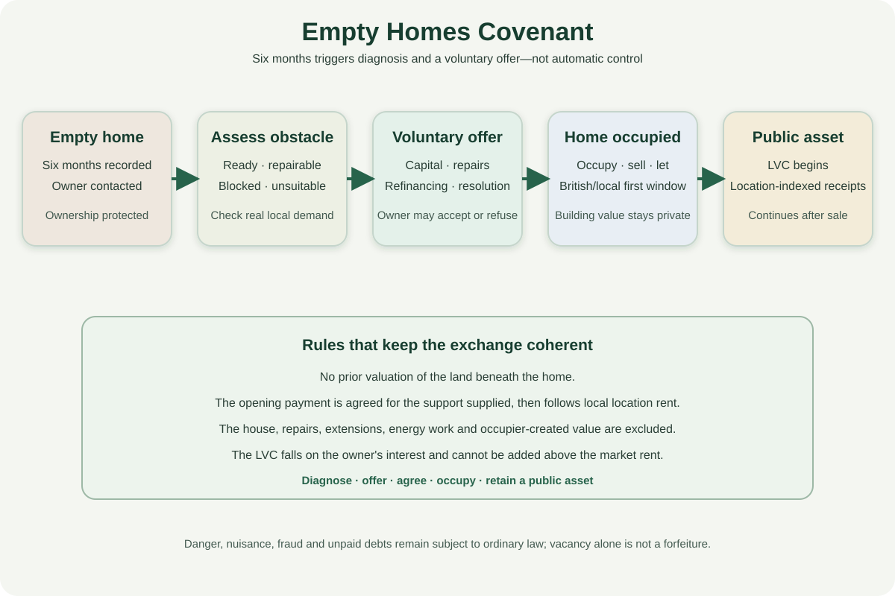

## Basic concept {#basic-concept}

An empty home is not necessarily an abandoned home. Some are between occupiers, being sold, awaiting probate, under repair, held while an owner receives care, affected by family or title disputes, or temporarily unsuitable for occupation. Others remain unused for years despite being habitable or capable of being restored.

The Empty Homes Covenant would distinguish between them. Once a home had remained empty for six months, the owner could be offered a voluntary package designed around the actual obstacle preventing occupation. The public fund might supply capital, repairs, refinancing, insurance support, professional services, help resolving title or probate difficulties, or a managed route to sale or letting.

In exchange, the owner would grant a continuing Location Value Covenant and make a binding commitment to return the home to occupation within an agreed period. The owner would retain the property, the rent, the value of the building and all privately financed improvements. Government would receive a continuing asset rather than taking over the home or making an unrecoverable grant.

There would be three routes:

| Route | Why the home is empty | What the covenant supplies |
| --- | --- | --- |
| **Ready Home Covenant** | The home is habitable but the owner lacks an attractive or manageable route to occupation | An upfront capital payment, refinancing, letting support or an agreed purchase route |
| **Repair and Return Covenant** | Repairs, safety work or modernisation prevent occupation | Approved works, services or long-term capital |
| **Blocked Home Covenant** | Probate, title, co-ownership, debt or another resolvable legal or administrative obstacle delays use | Professional resolution, settlement capital or bridging support |

The six-month point would trigger an offer and a proper assessment—not automatic state control. Homes presenting a genuine danger, serious nuisance, fraud or unpaid secured public debt would remain subject to the ordinary law, but mere vacancy would not be treated as wrongdoing.

### A voluntary alternative to Labour's management orders

On 27 September 2026, the government announced that eligibility for an Empty Dwelling Management Order would begin after six months rather than two years. An EDMO allows a council to take over management for up to seven years while legal ownership remains with the owner. The reform also removes evidential requirements concerning matters such as anti-social behaviour and community support for intervention. The [government announcement](https://www.gov.uk/government/news/new-reforms-to-bring-more-long-term-empty-homes-back-into-use--2) describes this as bringing long-term empty homes back into use.

The Empty Homes Covenant offers Restore Britain a clear alternative. It protects ownership, identifies the reason for vacancy, makes the owner a valuable voluntary offer and leaves compulsion for cases involving an established legal wrong—not the passage of six months alone.

This also fits Restore Britain's published commitment to [protect the British countryside and pursue infrastructure-first housing](https://www.restorebritain.org.uk/environment_infrastructure). Existing homes should be used intelligently before productive countryside is covered by unnecessary development. Reduced immigration would address excessive demand; the covenant would address waste within the housing stock already built.

### No prior land valuation

The agreement would not begin by separating and valuing the land beneath the empty home. The public fund and owner would agree what is to be supplied, the opening covenant payment, its commencement date and the obligation to return the home to use.

Government would value the covenant it receives from its expected payment stream, funding cost, administration, risk and indexation. Once established, the payment could follow the published local residential location-rent index. The house, repairs, extensions, energy improvements and the owner's or occupier's work would remain outside the LVC.

This is a policy proposal, not a currently available housing, finance or legal product. It would require legislation, standard agreements and independent advice.

## Worked example {#worked-example}

Assume a three-bedroom home has been empty for fourteen months. It is in a town where families want to live, but it needs £35,000 of roofing, electrical, heating and safety work. The owner inherited it with a small secured debt, has insufficient cash for the repairs and is unwilling to take a short-term commercial loan.

Under the Repair and Return Covenant:

1. The public LVC fund pays for approved works and settles £15,000 of expensive secured debt: total support of £50,000.
2. The owner grants an LVC with an illustrative opening payment of £2,000 a year.
3. No LVC is payable while the approved work is under way, subject to a six-month completion deadline.
4. The owner agrees to occupy, sell or let the finished home within three months of certification.
5. If it is sold, the purchaser pays a price reflecting the covenant and assumes its future payments.
6. If it is let, the owner receives the market rent and remains responsible for the covenant.

| Position | Without an agreement | With the Empty Homes Covenant |
| --- | --- | --- |
| Immediate repair and debt requirement | £50,000 | Supplied by the public fund |
| Initial annual LVC after occupation | £0 | £2,000 |
| Ownership | Retained | Retained |
| Obligation to return the home to use | None beyond existing law | Contractual deadline |
| Public asset after the work | None if support were a grant | Continuing indexed covenant |

The £2,000 payment is illustrative. Its value would be assessed as part of the complete exchange; it is not derived from a prior calculation of the land's value.

The LVC cannot be added on top of the rent the market already permits. Prospective tenants are already paying the most they are willing to pay for comparable homes. The covenant falls on the owner's economic interest and is capitalised into the property's selling price. If the home is sold to an occupier, the lower capital price can reduce the conventional mortgage required.

## How the LVC works {#how-it-works}

### What the numbers establish

The claim that Britain has about one million empty homes is reasonable as a broad description of all dwellings vacant at a particular time, but it must not be confused with the smaller stock of abandoned or long-term empty homes.

Different official sources count different things:

| Measure | Latest relevant figure | What it means |
| --- | --- | --- |
| England: all vacant dwellings, council-tax and housing-stock sources | 754,264 in October 2025 | Includes short-term vacancy and exempt dwellings across tenures |
| England: long-term vacant dwellings | 303,185 in October 2025 | Recorded as empty for more than six months |
| England: English Housing Survey physical-survey snapshot | About 1.2 million in 2024 | An estimate of every dwelling found vacant when surveyors visited, including ordinary gaps between occupiers; it is not an administrative count of long-term empty homes |
| Scotland: vacant or unoccupied-exempt dwellings | 89,400 in 2025 | 3.2% of Scotland's dwelling stock |
| Scotland: empty for more than six months and liable for council tax | 44,453 in September 2025 | A narrower long-term measure |

The English figures come from the [2025 dwelling-stock estimates](https://www.gov.uk/government/statistics/dwelling-stock-estimates-in-england-2025/dwelling-stock-estimates-england-31-march-2025) and the [English Housing Survey](https://www.gov.uk/government/collections/english-housing-survey-2024-to-2025-headline-findings-on-demographics-and-household-resilience). The Scottish figures come from [National Records of Scotland](https://www.nrscotland.gov.uk/publications/households-and-dwellings-in-scotland-2025/) and the [Scottish Government's empty-property statistics](https://www.gov.scot/publications/second-homes-and-empty-properties-in-september-2025/pages/empty-homes/).

There is no single current UK total compiled on a fully comparable basis. Census, survey and council-tax figures use different definitions and reference dates. The honest political formulation is therefore:

**Around a million homes may be vacant across the country at any one time, but the immediately relevant policy pool is the smaller group that has remained empty beyond normal turnover.**

The English Housing Survey figure is telling us how many homes are empty **at a moment in time**, not how many have been abandoned. Surveyors classify a dwelling according to what they find on the visit. The estimate therefore includes homes between a sale and completion, between tenants, awaiting a new owner, being modernised or temporarily empty for another reason. It is useful for measuring the total flow through vacancy, but the council-tax figure of approximately 303,000 homes empty for more than six months is the better starting point for this covenant.

### How many are ready to occupy?

No national register records whether every empty home is physically ready to move into. A precise percentage cannot currently be claimed.

The best evidence nevertheless supports the view that a substantial share of total vacancy is ordinary turnover rather than dereliction. In the 2024 English Housing Survey, 11% of private rented dwellings were vacant and 8 percentage points were awaiting another tenant or owner. In social housing, the corresponding figures were 4% and 3 percentage points. Across tenures, the rounded figures imply that roughly 55–60% of survey-recorded vacancy may have been awaiting its next occupier.

That is evidence of availability or transition, not proof of condition. Some awaiting an occupier will still require work, while some long-term empty homes will be immediately habitable. The covenant must therefore begin with a simple local classification:

1. **Ready:** safe and capable of occupation with cleaning or minor work.
2. **Repairable:** capable of occupation after a defined and economical package of work.
3. **Blocked:** physically usable but delayed by probate, title, ownership, finance or administration.
4. **Unsuitable:** structurally unsafe, uneconomic to restore, wrongly classified or not realistically usable as a home.

This assessment is of the obstacle and condition—not a valuation of the land.

The national evidence does not yet divide the empty stock cleanly between these four classes. It would be misleading to present invented precision. The English Housing Survey nevertheless provides two useful anchors: roughly 55–60% of survey-recorded vacancy appears to be awaiting another occupier, while [26% of vacant dwellings failed the Decent Homes Standard in 2023](https://www.gov.uk/government/statistics/english-housing-survey-2023-to-2024-drivers-and-impacts-of-housing-quality/english-housing-survey-2023-to-2024-drivers-and-impacts-of-housing-quality). Among homes awaiting an owner or tenant, 20% were non-decent, compared with 41% of homes vacant for other reasons.

This supports a qualified version of the claim that most empty homes are physically usable. About 74% met the Decent Homes Standard, and some of the non-decent remainder would need only economical repairs. But **physically usable** is not the same as **immediately available**: a decent home may still be blocked by probate, title, litigation or the statutory restriction described below.

For costing and testing the first pilot, the following should be used as a **working allocation**, not as a claim about the national stock:

| Covenant classification | Initial pilot assumption | Evidence and interpretation |
| --- | --- | --- |
| **Ready** | **50%** | Broadly consistent with the large turnover share after allowing for some homes awaiting an occupier that still need work |
| **Repairable** | **25%** | Anchored to the finding that 26% of vacant dwellings were non-decent; non-decent does not necessarily mean unsafe or uneconomic |
| **Blocked** | **20%** | A provisional allowance for physically usable homes delayed by probate, title, finance, co-ownership or administration |
| **Unsafe or unsuitable** | **5%** | A deliberately cautious pilot reserve for homes requiring fundamental reconstruction, demolition or a different use |

These proportions must be replaced by observed results from the pilot. Condition and cause are also different questions: a repairable home may simultaneously be blocked by probate. The operating register should record both, while placing each home in the route that determines its next action.

### Are they in the right locations?

The evidence does not support the suggestion that most empty homes are marooned where nobody wants to live. In England's 2025 council-tax data, about 89% of recorded empty homes were in intermediate or urban authorities: approximately 125,000 in intermediate authorities, 275,600 in urban authorities outside London and 81,800 in London. Only about 59,800—11%—were in majority-rural authorities.

Urban classification is not the same as proven demand for an individual property. A national scheme should therefore publish local vacancy alongside rents, prices, waiting lists, employment access and actual expressions of interest. An LVC offer should be made only where a credible occupier, buyer or letting route exists.

The proposal does not need every empty home to be usable. If even a minority of the long-term stock returns to occupation, the result arrives faster and with less construction than building the same number from scratch.

### Why six months is too crude for takeover

Six months is a reasonable point for a council to make contact, establish the facts and offer help. It is not a reasonable universal presumption that an owner has forfeited control.

Legitimate cases extending beyond six months include:

- Probate or administration of an estate;
- Active sale or letting during a slow transaction;
- Major repairs, structural work or an insurance claim;
- An owner receiving hospital or residential care;
- Divorce, co-ownership or title disputes;
- A job-related temporary absence;
- A home subject to planning, building-control or safety work;
- A home purchased for an identified family member who cannot yet move; and
- A property for which no viable occupier has yet been found.

Existing law recognises several such circumstances through exemptions, tribunal safeguards and special rules. The weakness of a blanket six-month message is that it treats duration as though it proves culpability. The covenant instead uses six months as a triage point and tailors the response to the reason.

### An incoherent collision with the Renters' Rights Act

The [Renters' Rights Act 2025 has applied to private tenancies in England since 1 May 2026](https://www.gov.uk/guidance/renters-rights-act-an-overview-for-landlords). Where a landlord recovers possession because the landlord or a close family member intends to move in, or because the landlord intends to sell, the Act normally prevents the property from being marketed **for letting** or re-let for twelve months. Sale marketing may continue. The restriction is designed to stop a false sale or occupation ground being used to remove a tenant.

That protection has a rational purpose, but it conflicts with the new empty-homes timetable. A landlord may recover a home for a genuine sale, fail to find a buyer at the desired price, and be legally prevented from returning it to the rental market. After six months the same government would treat the resulting vacancy as sufficient to make the home eligible for council management. One policy can therefore require vacancy while another penalises it.

The Empty Homes Covenant can resolve rather than compound that conflict:

1. A documented statutory no-relet period should pause the six-month management-order clock where the sale was genuine and the owner remains compliant.
2. Before possession is sought, the sitting tenant should be offered the opportunity to buy through the Tenant and Rental Covenant where appropriate.
3. If an open-market sale stalls, a **Covenant Sale Offer** could exchange an LVC for an immediate reduction in the capital price, reducing the purchaser's conventional mortgage and widening the pool of buyers.
4. If no sale completes, the fund could agree refinancing, essential work and a binding plan to re-let immediately when the statutory restriction expires.

The covenant must not become a device for evading tenant protection. Eligibility would require evidence of the possession ground, genuine marketing, asking-price history and compliance with the Act. Its purpose is to prevent a legally imposed vacancy from becoming grounds for a second state intervention.

### Inheritance Tax, probate and inherited empty homes

An inherited home may remain empty while executors establish title, value the estate, calculate tax, obtain finance and secure the grant of probate needed to complete a sale. Where Inheritance Tax is due, tax administration and the need to finance an initial payment can add a real obstacle. Property-related tax may be paid by instalments in some circumstances, but interest and estate liquidity remain relevant.

Abolishing Inheritance Tax would remove the tax valuation, payment and financing barrier for taxable estates. It would reduce pressure for a hurried sale, allow executors to obtain probate without first arranging an IHT payment, and make it easier to decide rationally whether to occupy, repair, let or sell the inherited home. It would also remove a source of delay that the six-month empty-home rule would otherwise punish.

The scale must be stated accurately. [HMRC reports that 4.72% of UK deaths resulted in an IHT charge in 2023–24](https://www.gov.uk/government/statistics/inheritance-tax-liabilities-statistics/inheritance-tax-liabilities-statistics-commentary)—fewer than one in twenty. Abolition could therefore materially improve the position of the affected estates, particularly property-rich but cash-poor estates, but it would not solve most empty homes and it would not abolish probate, title disputes or executor delay. There is no national dataset linking IHT-liable estates to long-term empty homes, so a numerical reduction in vacancy cannot honestly be claimed.

Restore Britain's preferred policy should therefore be two-stage:

- **Abolish Inheritance Tax**, removing the state-created tax obstacle altogether; and
- Offer the **Blocked Home Covenant** for the remaining probate, title, repair and co-ownership obstacles.

Until abolition takes effect, the covenant fund could, at the executor's request, supply temporary estate liquidity, repairs or an agreed tax payment in exchange for an LVC and a firm occupation or sale timetable. This would be a voluntary bridge, not a valuation of the land and not a substitute for the wider policy of abolition.

### The voluntary process

1. At six months, the authority checks occupancy status and contacts the registered owner.
2. The owner gives the reason for vacancy and chooses whether to request a covenant assessment.
3. The home is classified as ready, repairable, blocked or unsuitable.
4. Where credible demand exists, the public fund makes a complete offer stating the support, opening LVC, index, deadline and route to occupation.
5. The owner accepts or rejects it freely. Existing ownership is not weakened by refusal alone.
6. Support is released against verified milestones.
7. The home is occupied, sold or let by the contracted deadline, and the covenant begins as agreed.
8. The covenant remains with the property on later sale and its effect is reflected in the price.

### British families and local first opportunity

Restore Britain's published housing position is “British homes for British families.” An Empty Homes Covenant funded by the state could therefore include a limited first-opportunity period for qualifying British citizens and established local households before wider marketing, subject to legislation and equalities review.

That priority should not require a bureaucrat to allocate every home. Owners could market through ordinary estate and letting agents while observing the agreed first-opportunity window. If no qualifying occupier proceeds within it, the home should enter the wider market rather than remain empty.

### Protecting the owner and the public fund

The agreement should disclose the complete cost, payment, indexation and enforcement terms before signature. Independent advice should be available, particularly for elderly owners, estates and jointly owned homes.

If the owner takes the support but deliberately fails to complete the agreed work or return the home to use, the fund could suspend further assistance, recover defined costs or enforce the contractual milestones. That is enforcement of a voluntary bargain, not confiscation for vacancy.

Fraudulent occupancy claims, dangerous structures, serious statutory nuisance and unpaid debts would continue to be addressed through the relevant ordinary powers. The LVC should not shelter unlawful conduct.

## The beneficiaries {#beneficiaries}

- **Empty-home owner — why would I do this?** I receive capital, repairs, refinancing or practical resolution without surrendering my home to council management. I retain ownership, rental income, the building and the value of my improvements. I accept a continuing disclosed payment and a lower future sale price.
- **Person or family seeking a home:** I gain access to an existing home in an established place, potentially much sooner than a new development could be completed. If I buy it, the covenant reduces the capital price and conventional mortgage required. If I rent it, the LVC cannot be added above the market rent.
- **Government:** It obtains a continuing location-linked asset rather than paying a disappearing grant. It can reduce enforcement, tribunal and temporary-accommodation pressures while restoring council-tax and wider economic activity.
- **Local authority:** It receives a practical first response at six months: diagnose, offer and contract. Scarce compulsory powers can concentrate on genuine danger, nuisance, fraud and persistent legal default.
- **Neighbour and community:** An occupied home is maintained, heated and watched. Long-term decay, vermin, dumping, vandalism and damage to adjoining property become less likely.
- **Lender:** Necessary repairs and occupation can protect the security. Expensive or distressed borrowing may be reduced, although the covenant must be disclosed and reflected in valuation and affordability.
- **Future purchaser:** I see the covenant before buying, pay a correspondingly lower price and retain the full value of improvements I later make.
- **Taxpayer:** Existing housing is used before more countryside, infrastructure and public money are committed to replacement construction.

No stakeholder receives something for nothing. The state supplies value and receives a covenant; the owner supplies the covenant and occupancy commitment; the new occupier brings the home back into living use.

## Policy effect {#policy-effect}

The Empty Homes Covenant gives Restore Britain a property-rights answer to a genuine housing-stock problem. Labour's policy begins with an earlier power to take control. This proposal begins by asking why the home is empty and making the owner an offer capable of solving it.

It is also more fiscally coherent than a simple renovation grant. Every successful agreement adds a continuing public asset. As receipts grow, they can help replace taxes on work, construction and enterprise rather than merely financing another housing intervention.

The policy works from the bottom up. Ready homes can return first; modest repairs follow; complicated legal and structural cases receive specialist treatment; unsuitable properties are not forced through an artificial process. Local demand determines where offers are worthwhile.

For Restore Britain, the political contrast is clear:

| Labour management-order approach | Empty Homes Covenant |
| --- | --- |
| Six months creates eligibility for state management | Six months triggers contact and a voluntary offer |
| Duration treated as the main threshold | Reason, condition and local demand assessed |
| A genuine failed sale can collide with the Renters' Rights Act's 12-month no-relet period | Statutory safe harbour plus an LVC-assisted sale or timed return to letting |
| IHT can obstruct probate and the orderly disposal of some inherited homes | Abolish IHT; use the Blocked Home Covenant for the obstacles that remain |
| Council may manage the home for up to seven years | Owner retains control and agrees an occupation deadline |
| Public intervention recovered through managed rent where possible | Public support exchanged for a permanent LVC asset |
| Uniform national coercive power | Local, property-specific voluntary bargain |

The covenant will not make every recorded vacancy available. Nor should it: a functioning housing market always contains homes between occupants, and legitimate life events take time. Its purpose is to identify the genuinely recoverable stock and make voluntary occupation more attractive than continued emptiness.

The governing principle is:

**Use the homes Britain has, protect the owners who hold them, give British families the first opportunity, and turn public support into a permanent public asset.**

A pilot should publish results by reason for vacancy, condition, location, time empty, support supplied, occupation route, time to occupation and covenant value. That evidence would replace slogans with a reliable national picture and allow the scheme to expand where it demonstrably works.
