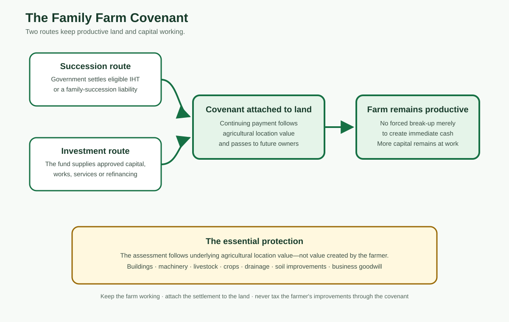

## Basic concept {#basic-concept}

Many working farms are valuable as property but produce comparatively modest and variable cash incomes. A tax liability or major investment requirement can therefore be affordable in terms of the farm's underlying land value but impossible to meet from one year's trading income.

The Family Farm Covenant would allow a qualifying farm to exchange an immediate capital requirement for a continuing Location Value Covenant attached to its agricultural land. The farm could remain intact and productive rather than selling land, exhausting working capital or taking an equivalent conventional mortgage.

There would be two routes within the same application:

| Route | Immediate problem | What the public fund supplies |
| --- | --- | --- |
| **Farm Succession Covenant** | An inheritance-tax or qualifying family-succession liability threatens the continuity of the farm | Full or partial settlement of the liability |
| **Farm Investment Covenant** | A viable farm lacks affordable long-term capital | Approved capital, works, services or refinancing |

The inheritance-tax route is the immediate answer to the concern expressed through recent farmers' protests: a family should not have to break up a viable working farm merely to turn illiquid land into cash at the moment of succession.

This would not make an inheritance-tax liability disappear. Government would accept a long-lived, revenue-producing covenant asset in full or partial settlement. The successor would inherit a farm with a lower uncovenanted sale value and a continuing payment, but without first having to raise the same capital sum in cash.

The investment route applies the same principle during the farm's working life. It could support agricultural buildings, water management, drainage, soil restoration, machinery, energy systems, resilience, diversification or the replacement of expensive land-related debt.

This is a policy proposal, not a currently available method of paying UK inheritance tax or financing a farm. Individual tax, legal, valuation, lending and succession advice would remain essential.

## Worked example {#worked-example}

Assume a simplified estate contains £5 million of qualifying agricultural and business property. Under the rules applying from 6 April 2026, the first £2.5 million qualifies for 100% Agricultural Property Relief or Business Property Relief and qualifying value above that receives 50% relief.

The [government's summary of the APR changes](https://defrafarming.blog.gov.uk/tag/industrial-strategy/) confirms the £2.5 million combined allowance. A [Parliamentary committee report on farming in Wales](https://committees.parliament.uk/publications/50127/documents/270460/default/) records both the concern created by the reforms and the wide disagreement about how many working farms will ultimately be affected.

Ignoring other assets, exemptions, ownership arrangements and allowances solely to illustrate the mechanism:

| Simplified calculation | Amount |
| --- | ---: |
| Qualifying agricultural and business property | £5,000,000 |
| Amount receiving 100% relief | £2,500,000 |
| Remaining qualifying value | £2,500,000 |
| 50% relief on the remaining value | £1,250,000 |
| Value remaining chargeable to IHT | £1,250,000 |
| Illustrative IHT at 40% | £500,000 |

The actual bill could be different because inheritance tax depends on the estate, ownership, lifetime transfers, available allowances and the detailed conditions for APR and BPR.

Without an LVC, the successors might have to find £500,000 from other assets, sell part of the farm, reduce investment, use statutory instalments or borrow against the land. Even where instalments are available, a large fixed annual payment can compete directly with wages, machinery, livestock, maintenance and resilience investment.

Under the Farm Succession Covenant, government instead accepts a £500,000 covenant asset in settlement of the illustrative liability. If the initial covenant payment were set at an illustrative 4% of the settled amount, the opening payment would be:

**£500,000 × 4% = £20,000 a year**

| Illustrative route | Immediate capital required | Initial annual commitment | What happens to the farm |
| --- | ---: | ---: | --- |
| Pay immediately | £500,000 | None after payment | Working capital or other assets are used |
| Sell agricultural land | Sale proceeds fund £500,000 | None after payment | The holding may become smaller or less viable |
| Ten equal instalments | £50,000 initially each year | Finite but comparatively concentrated | Cash flow is committed during the succession period |
| Family Farm Covenant | No £500,000 cash payment | £20,000 initially, then location-indexed | The farm remains intact and the covenant passes with the land |

The instalment comparison is deliberately simplified and does not reproduce every statutory condition, interest rule or event that may accelerate payment. The covenant figure is also illustrative: an independent valuation would have to account for funding costs, administration, risk, indexation and the expected duration of the asset.

The £500,000 is not a gift to the successors. The covenant would normally reduce the market price of the farm by approximately the capital value attributed to its future payments. If the family later sold, the purchaser would pay a correspondingly lower price and assume the covenant.

A separate Farm Investment Covenant could work in the same way. For example, a public fund might provide £200,000 for approved water storage, drainage and agricultural buildings in exchange for an illustrative initial payment of £8,000 a year. The contractor would be paid immediately, while the farm retained more working capital for production.

## How the LVC works {#how-it-works}

### Farm Succession Covenant

1. The inheritance-tax liability is calculated under the law applying to the estate. The LVC does not determine how much tax is due.
2. The successors choose whether to settle all or part of the eligible liability using a covenant.
3. Government values the proposed covenant, including its expected receipts, funding cost, administration, risk and indexation.
4. The covenant is registered against the qualifying agricultural land and the corresponding tax liability is treated as settled.
5. The successor continues operating or letting the farm and makes the continuing payments.
6. If the land is sold, the covenant remains attached. Its effect is reflected in the price and the purchaser assumes the payment.

The covenant therefore differs from both a tax exemption and a deferred tax debt. Government receives an asset immediately, while the obligation remains with the land across ownership changes instead of becoming a personal loan that one generation must repay to zero.

### Farm Investment Covenant

1. The farmer, landowner or farming partnership proposes a defined productive project or refinancing requirement.
2. The public fund assesses viability, additionality, environmental effects and the value of the support supplied.
3. Approved capital, work or equipment is paid for or supplied.
4. A separately identified covenant component is registered against the land.
5. Its payment follows the agreed agricultural location-value index, not the value created by the project.

Where a tenant operates the farm, the arrangement may need the tenant, landowner, lender and public fund to agree how the investment and covenant are allocated. A tenant should not pay permanently for an asset retained by the landowner without receiving a corresponding contractual advantage.

### Protecting farmers' improvements

The valuation boundary is fundamental. The LVC may follow the agricultural economic rent attributable to the land's inherent qualities, permitted use and location. It must not capture value created by the farmer's labour or capital.

The assessment must therefore exclude increases attributable to:

* Farmhouses and domestic occupation except where expressly and lawfully included;
* Barns, stores, livestock buildings and other structures;
* Machinery, vehicles and equipment;
* Livestock, crops and stored produce;
* Drainage, irrigation and water-storage works;
* Soil restoration and privately financed environmental improvements;
* Renewable-energy equipment;
* Tenants' improvements; and
* The goodwill and earning capacity of the farming business.

A farmer must never face a higher covenant payment merely because the farm has been improved or made more productive. Otherwise the LVC would become another tax on production and contradict its purpose.

### Change of use and sale

If land remains in agriculture, the agricultural index continues. If planning permission or an actual lawful change of use gives the location a materially different economic value, the scheme would need published rules for moving to the appropriate index. The increase should arise from the changed location rights—not from buildings or works paid for by the owner.

Sale would not trigger repayment of a conventional principal balance. The purchaser would see the payment and indexation before buying, offer a price that reflects them and take responsibility after completion. A redemption option could be provided, but only at a transparent actuarial value that leaves the public fund financially whole.

### Eligibility and anti-avoidance

Eligibility should concentrate on genuine agricultural activity rather than passive acquisition of farmland for tax planning. Rules could require evidence of active farming or a genuine agricultural tenancy, minimum ownership or occupation periods, transparent beneficial ownership and continued agricultural use.

The LVC itself supplies an additional safeguard: selling the land does not erase the public claim. The covenant follows the property and continues producing revenue. This allows policy to protect farm continuity without giving a windfall to someone who inherits agricultural land and immediately sells it.

## The beneficiaries {#beneficiaries}

* **Working farmer or successor — why would I do this?** I can keep the productive holding together and avoid raising the full liability through an immediate sale, concentrated instalments or an equivalent mortgage. I accept a continuing payment and a lower future selling price.
* **Farm investing during its working life:** I obtain long-term capital for approved productive or resilience improvements without surrendering the improvement to the public fund or having its value added to my LVC assessment.
* **Outgoing family members and other beneficiaries:** A covenant may provide the capital needed for a fair settlement without forcing the operating successor to dismantle the business. Their interests must be valued and advised independently.
* **Government:** It receives a legally enforceable, continuing asset rather than simply cancelling the liability or making an unrecoverable grant. The arrangement must be independently valued so that its expected net worth justifies the amount settled or invested.
* **Mortgage lender:** The farm may require less land-secured borrowing, but the lender must account for the covenant in affordability, priority and security valuations.
* **Tenant farmer:** A properly structured agreement can bring investment to the holding without transferring an unfair permanent cost to a tenant who does not own the resulting asset.
* **Rural community:** A viable farm can retain employment, local purchasing, food production, stewardship and the interdependent businesses that rely upon it.
* **Future purchaser:** I pay a price reflecting the covenant and assume its disclosed payment. I do not pay the uncovenanted price and then receive an undisclosed extra charge.

No participant receives something for nothing. The purpose is to replace a destructive demand for immediate capital with a transparent property-linked exchange that preserves productive capacity.

## Policy effect {#policy-effect}

The Family Farm Covenant directly addresses the strongest economic objection raised during the farmers' inheritance-tax protests: agricultural land can carry a high capital valuation without generating enough liquid income to meet a large tax charge safely.

The proposal does not require government to choose only between collecting immediate cash and exempting the farm completely. It offers a third course: settle the liability with a continuing public asset while the productive farm remains intact.

Its wider economic effect could be significant. Forced or tax-driven land sales may fragment holdings, interrupt succession, increase mortgage debt and divert capital away from buildings, machinery, soil, livestock and resilience. Replacing that pressure with a covenant can preserve productive investment while moving part of public revenue away from taxes that fall on work and enterprise.

The Farm Investment Covenant extends the same principle beyond inheritance. It gives viable farms another way to finance long-lived improvements while ensuring that privately created value remains private. Government receives location-linked revenue; farmers retain the full value of their buildings, equipment, improvements and work.

The scheme would require detailed legislation covering APR and BPR interaction, land registration, valuation, tenancies, lender priority, trusts, partnerships, change of use, default and redemption. It should be optional, independently advised and piloted before national adoption.

The intended direction is nevertheless simple:

**Keep the farm working; attach the settlement to the land; never tax the farmer's improvements through the covenant.**

Current tax rules can change. The worked example reflects the broad APR and BPR framework applying from 6 April 2026 and is included only to explain the proposed mechanism.
