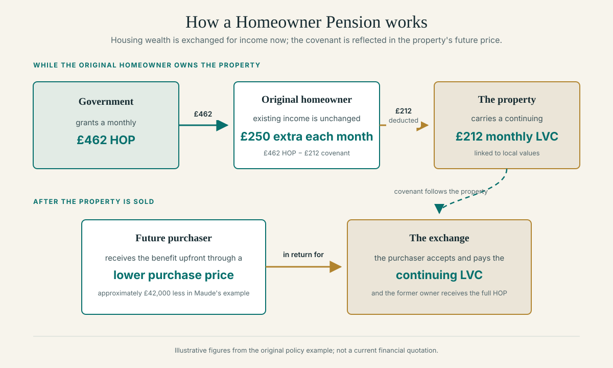

## Basic concept {#basic-concept}

Older homeowners may want extra income for travel, family support or rising bills. Conventional equity-release products have commercial terms, pricing and protections.

A Homeowner Pension uses a Location Value Covenant rather than a conventional equity-release loan. In return for the covenant being attached to the property, government pays the homeowner a monthly Homeowner Pension. The covenant payment is due from whoever owns the property.

While the pension recipient still owns the home, the covenant payment can be deducted from the Homeowner Pension before the balance is paid. This does **not** mean that the homeowner pays the covenant from her existing State Pension or other retirement income. The Homeowner Pension and the covenant arise together, and their difference is new disposable income.

The original proposal was designed for homeowners over 50.

## Worked example {#worked-example}

Maude is 74 and owns a central Cambridge house valued at approximately £180,000 in the original briefing. She wants £250 of additional income each month.

Under the worked example:

* Her existing income continues unchanged.
* Government grants her a Homeowner Pension of £462 per month.
* While she owns the property, its £212 monthly covenant payment is deducted from that new pension.
* Maude therefore receives £250 per month on top of her existing income.

In simple terms:

**£462 Homeowner Pension − £212 covenant payment = £250 additional monthly income**

Both amounts increase on the terms of the scheme. The covenant payment is linked to local values and remains payable by whoever owns the property.

If Maude sells, the purchaser takes the property subject to the covenant and its price should fall to reflect that continuing obligation. The purchaser then pays the covenant, while Maude continues to receive the full Homeowner Pension of £462 per month. When Maude dies, her Homeowner Pension ends, but the covenant remains attached to the property.

| Case | Additional annual income | Annual covenant | Estimated price reduction |
| --- | --- | --- | --- |
| Maude, 74 | £3,000 | £2,544 | £42,000 |
| Ronald, 65 | £3,000 | £3,145 | £52,000 |
| Liz, 50 | £3,000 | £4,737 | £79,000 |

The figures come from the original briefing and are illustrative rather than current quotations.

## How the LVC works {#how-it-works}

### Why does the covenant increase for a younger homeowner? 

The younger the homeowner is when the Homeowner Pension begins, the longer government is likely to make pension payments. The original examples therefore assign a larger covenant to a younger recipient in exchange for providing the same £250 of additional monthly income over a longer expected lifetime. This is why Liz's annual covenant and estimated reduction in property value are greater than Maude's.

### Is the covenant unfair to a future owner? 

The future owner does not receive Maude's Homeowner Pension, but they should not pay the price of an otherwise identical property without a covenant. The continuing payment reduces what purchasers are willing and able to pay for the property. In the original example, Maude's house is therefore estimated to sell for approximately £42,000 less than it would without the covenant.

The purchaser's exchange is:

**lower purchase price and a smaller mortgage, in return for taking on the continuing covenant payment**

The purchaser is not paying Maude's covenant for nothing. The benefit is received upfront through the discounted purchase price rather than as a monthly pension. If the purchaser later sells, the covenant remains with the property and should again be reflected in its sale price.

This is economically fair only if:

* The covenant is clearly registered and disclosed before purchase.
* Buyers and mortgage lenders include the payment when assessing affordability.
* The price discount reasonably reflects the expected continuing payments and their indexation.
* Purchasers understand that the covenant may rise or fall under its stated location-value formula.

The estimated price reduction is not guaranteed to equal every payment eventually made. Its market value will depend on interest rates, expected increases in the covenant, local demand and buyers' attitudes to the obligation. A transparent valuation method and clear consumer protections would therefore be essential.

### How might the income be taxed?

The original proposal describes the Homeowner Pension as tax-free. That would be a deliberate policy choice requiring legislation; calling the payment a “pension” would not by itself determine its tax treatment.

Economically, the arrangement converts part of the homeowner's property wealth into an income stream. It is therefore not exactly the same as an occupational or State Pension. There are two possible approaches:

* **Simple treatment:** make the whole Homeowner Pension tax-free, as the original proposal intended. This is easy to understand and is broadly consistent with treating the arrangement as the release of the homeowner's own capital.
* **Capital-and-income treatment:** calculate how much of each payment represents the return of housing capital and how much represents income or financial return. The capital element would be tax-free and only the income element would count as taxable income, broadly following the principle used for purchased life annuities.

It would be misleading to add the gross £462 to Maude's taxable income while disregarding the £212 covenant payment. While she owns the property, the scheme increases her available income by £250 per month, not £462. Any legislation should therefore define the tax treatment of the Homeowner Pension and covenant together.

Income Tax and means-tested benefits are separate questions. Even if some or all of the Homeowner Pension were tax-free, legislation would also need to state how it affects Pension Credit, council tax support, care funding and other means-tested assistance.

## The beneficiaries {#beneficiaries}

* **Homeowner — why would I do this?** I receive income in addition to my existing pension or other income, without selling my home or taking a conventional equity-release loan on which interest may compound. I am exchanging part of the property's future sale value—and potentially part of my beneficiaries' inheritance—for more disposable income during my lifetime.
* **Future purchaser:** I do not receive the original owner's Homeowner Pension, but I acquire the property at a lower price and require less mortgage debt. In exchange, I accept the disclosed covenant payment for as long as I own the property, and the covenant should again be reflected in the price when I sell.
* **Government:** It acquires a continuing, location-linked revenue asset and provides a transparent public alternative to commercial equity release. The pension ends on the agreed terms, while the covenant continues with the property.
* **Bank:** Its direct role may be limited, but it can provide account, payment and administration services without assuming the long-duration interest and property-value risks associated with conventional equity release.

This option is most attractive to a homeowner who places greater value on income and financial independence during retirement than on preserving the maximum possible property inheritance.

## Policy effect {#policy-effect}

The proposal creates a public alternative to commercial equity release. It converts part of a property's future value into additional retirement income while making the continuing obligation visible in the future sale price and the next owner's costs. It does not create the extra income by reducing the homeowner's existing pension: the new Homeowner Pension exceeds the covenant payment while she owns the property.
