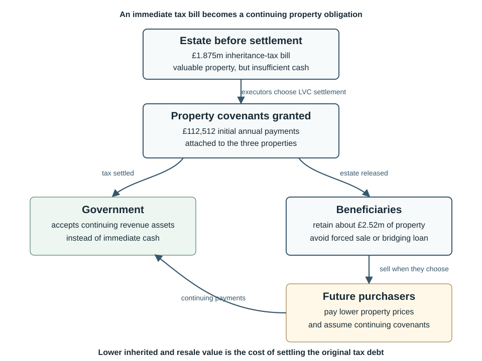

## Basic concept {#basic-concept}

An estate can contain valuable property but too little cash to pay its inheritance-tax bill. The executors may then have to borrow against the estate or sell property—potentially quickly and before the beneficiaries are ready.

Under this proposal, the inheritance-tax liability is instead converted into continuing Location Value Covenant payments attached to the inherited properties. Government accepts the covenants in settlement of the tax bill and releases the estate.

This does not make the tax disappear. The beneficiaries receive properties with lower market values and continuing payments attached to them. What changes is the form and timing of settlement: an immediate cash liability becomes a long-term obligation carried by the properties.

This is a policy proposal, not a currently available way to settle UK inheritance tax.

## Worked example {#worked-example}

Sir James St’John leaves an estate valued at £5 million, including two London properties and a country estate. His executors face an illustrative £1,875,200 inheritance-tax bill but do not have enough cash to pay it.

Instead of arranging a bridging loan or immediately selling one or more properties, the executors place covenants on the three properties. The initial annual payments are set at 6% of the inheritance-tax liability and allocated between the properties.

| Property | Value without covenant | Value with covenant | Reduction in value | Annual covenant |
| --- | ---: | ---: | ---: | ---: |
| London property 1 | £1,200,000 | £730,000 | £470,000 | £28,128 |
| London property 2 | £1,100,000 | £630,000 | £470,000 | £28,128 |
| Country estate | £2,100,000 | £1,160,000 | £940,000 | £56,256 |
| **Total** | **£4,400,000** | **£2,520,000** | **£1,880,000** | **£112,512** |

The three covenants total £112,512 a year:

**£1,875,200 × 6% = £112,512**

The illustrated reduction in the properties’ combined market value is £1,880,000—approximately equal to the £1,875,200 tax liability. The £4,800 difference is a rounding effect in the original property figures.

## How the LVC works {#how-it-works}

## The beneficiaries {#beneficiaries}

* **Executors and beneficiaries — why would we do this?** We can settle an existing inheritance-tax debt without first finding £1,875,200 in cash. This can avoid a hurried property sale or expensive bridging finance and lets us decide whether to retain, occupy or sell each property. In exchange, we accept lower property values and continuing covenant payments.
* **Government:** It receives legally enforceable, continuing, location-linked revenue assets in place of immediate cash. If properly valued and administered, those assets can preserve the economic value of the tax settlement over time.
* **Bank:** The estate may need less short-term secured borrowing. A bank can still finance a beneficiary or future purchaser, but against a lower purchase price and with the covenant included in its affordability and security assessment.
* **Future purchaser:** I pay substantially less for the property and may need a smaller mortgage. In return, I assume the disclosed continuing covenant payment, which will again be reflected in the price when I sell.

### What does the homeowner actually gain? 

The beneficiary does not receive free money and is not made £1,875,200 richer. The estate already owes that amount in tax. The choice is about how the liability is met.

Without the LVC, the executors may have to:

* Sell a property to raise the tax;
* Arrange short-term borrowing and pay interest and fees; or
* Use other liquid assets that would otherwise pass to the beneficiaries.

With the LVC, the tax bill is settled without first raising £1,875,200 in cash. The beneficiaries can retain the properties, decide later whether to occupy or sell them, and avoid a sale driven solely by the tax deadline.

The cost is equally real. They inherit properties worth about £2,520,000 subject to the covenants, rather than the same properties worth £4,400,000 without them. Whoever owns each property must make its continuing covenant payment.

The compelling comparison is therefore not:

**“Give up £1.88 million merely to delay a tax payment.”**

It is:

**“Use approximately £1.88 million of property value to settle an existing £1.875 million tax debt, while avoiding the need to raise that sum immediately through borrowing or forced sales.”**

### What happens if a beneficiary sells? 

The covenant remains attached to the property. The beneficiary sells at the lower covenanted market price and stops making the covenant payment. The purchaser assumes the payment as the new owner.

The lower selling price is not an additional loss on top of the inheritance-tax bill. It is how the market reflects the liability that settled that bill. If the covenant were absent, the estate would still have had to find the tax money from a sale, borrowing or other assets.

### What does a future purchaser receive?

The purchaser did not inherit the estate and receives no inheritance-tax concession. Their benefit is the lower purchase price.

For example, the first London property is shown at £730,000 with the covenant rather than £1,200,000 without it. The purchaser therefore needs £470,000 less purchase capital, but accepts the £28,128 annual covenant and its future indexation.

The exchange is:

**Lower purchase price and less mortgage debt ↔ continuing covenant payment**

The purchaser must be shown both sides clearly. A lower price does not by itself guarantee a better lifetime bargain: a mortgage is normally repaid over a finite term, whereas the covenant continues and may change with local location values. The price, payment, indexation and legal obligation must therefore be transparent and included in affordability assessments.

## Policy effect {#policy-effect}

The proposal converts a large, immediate inheritance-tax liability into continuing obligations attached to the properties from which much of the estate’s value arises.

It can reduce the pressure for deadline-driven sales and bridging loans. It also reduces the purchase price and mortgage debt required by later buyers, while giving government a continuing revenue stream linked to local location values.

Economically, the beneficiaries still bear the inheritance-tax cost through lower inherited property value and covenant payments. The proposal changes liquidity, timing and financing; it should not be presented as eliminating the tax burden.

### Why precise land value is not required 

The inheritance-tax liability is calculated first under the ordinary tax rules. That known liability—not a fresh calculation of each plot’s exact land value—determines the initial capital amount to be converted into covenants.

The liability is allocated between the properties and converted into annual payments. In the example, the total initial payment is simply 6% of the £1,875,200 liability.

Local land or rental values are then used as an index to adjust the payments over time. The system needs a reliable measure of how relevant local location values change, but it does not need to isolate and price every attribute of each plot merely to establish the original tax settlement.

Property-specific market valuations still matter for allocating the liability sensibly, showing the likely price effect and protecting beneficiaries and purchasers. That is different from requiring a precise standalone valuation of the land beneath each building.
