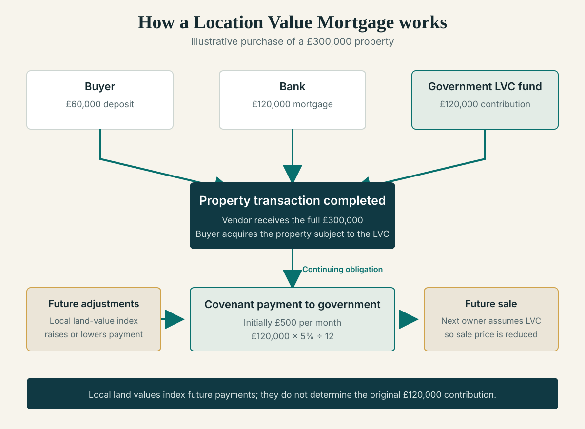

## Basic concept {#basic-concept}

Large bank loans can jeopardise financial stability and expose homeowners to negative equity when prices fall.

A Location Value Mortgage advances public funds to a buyer without creating a repayable, interest-bearing debt. In exchange, the buyer enters into a Location Value Covenant and the property owner pays an index-linked sum to the state each month in perpetuity.

A bank can handle the paperwork. On completion, government pays the agreed contribution through the bank and the covenant is registered. The initial covenant payment is calculated from that contribution at the applicable rate and is subsequently adjusted in line with local land values. A separate valuation of the individual plot is not required. The bank has no further involvement with that part of the arrangement.

## Worked example {#worked-example}

Sharon and Kevin Smith are buying a £300,000 house with a £60,000 deposit. MegaBank will lend £240,000 at 7% or £120,000 at 6%. A £120,000 Location Value Mortgage is available with an initial covenant payment of £500 per month. This is initially equivalent to 5% of the public contribution and is subsequently adjusted in line with local land values.

| Measure | Traditional mortgage | Location Value Mortgage |
| --- | --- | --- |
| Vendor receives | £300,000 | £300,000 |
| Value of purchaser’s interest after covenant | £300,000 | £180,000 |
| Deposit | £60,000 | £60,000 |
| Bank loan | £240,000 | £120,000 |
| Public contribution | — | £120,000 |
| 300 bank repayments | £1,696 | £773 |
| Covenant payment | — | £500 |
| Monthly total | £1,696 | £1,273 |
| Illustrative saving | — | £423 |

The household also considers an identical house in a less expensive location for £180,000. The same £120,000 Location Value Mortgage is available with the same initial £500 monthly covenant payment. With their £60,000 deposit, no bank loan is required. 

| Measure | Traditional mortgage | Location Value Mortgage |
| --- | --- | --- |
| Vendor receives | £180,000 | £180,000 |
| Value of purchaser’s interest after covenant | £180,000 | £60,000 |
| Deposit | £60,000 | £60,000 |
| Bank loan | £120,000 | £0 |
| Public contribution | — | £120,000 |
| Bank repayment | £773 | £0 |
| Covenant payment | — | £500 |
| Illustrative saving | — | £273 |

### How the transaction works

### Why would I choose this?

* **Homeowner — why would I do this?** I require a smaller mortgage and make lower combined monthly payments. This reduces my exposure to mortgage interest rates, negative equity and repossession. In exchange, I accept a continuing LVC payment, and the market value of my interest in the property is lower because a future purchaser must assume the same obligation.
* **Government:** It acquires a continuing, index-linked public revenue asset rather than making an unrecoverable grant. It can also reduce dependence on bank-created mortgage credit and improve financial stability.
* **Bank:** It provides a smaller, lower loan-to-value mortgage with less default and negative-equity risk, while retaining the customer relationship. The trade-off is that it earns interest on a smaller loan.

The homeowner is therefore choosing between financing more of the purchase with an interest-bearing mortgage or replacing part of that mortgage with a continuing covenant payment. The LVC is most attractive to someone who values lower monthly costs and greater financial resilience today, while accepting that the covenant will reduce the property’s future sale price.

The initial LVC is not calculated by separating the building from the land or by measuring a precise share of the plot’s value. The agreed public contribution determines the initial payment, and a local land-value index determines how that payment changes afterwards.

## Policy effect {#policy-effect}

The proposal adds another choice, allowing families to balance deposit, borrowing and covenant against their circumstances. Its central promise is more predictable budgeting based on local rental values rather than interest rates.

| Participant | Potential advantage | Potential disadvantage |
| --- | --- | --- |
| Homeowner | Lower cost; reduced negative-equity and default risk | Less exposure to property-price gains |
| Bank | Lower default risk | Less interest income |
| Government | Continuing public revenue | Funds the initial contribution |
