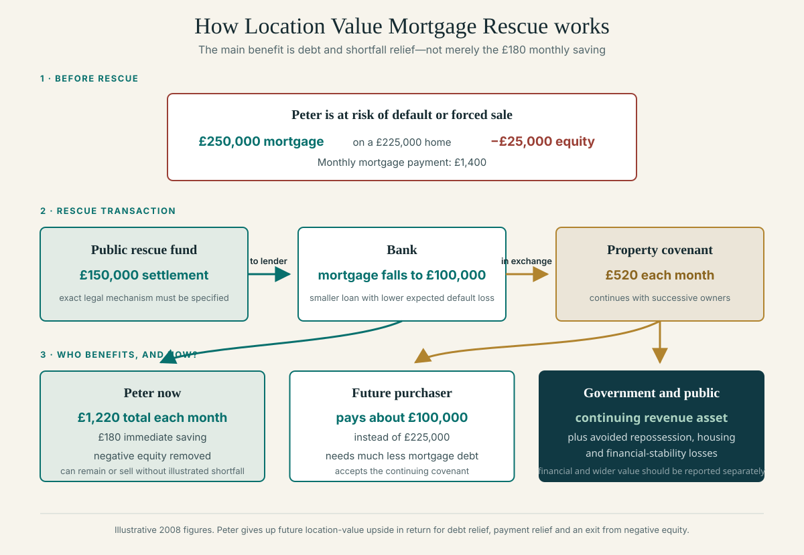

## Basic concept {#basic-concept}

Location Value Mortgage Rescue is intended for a homeowner who can no longer carry a large mortgage and may otherwise face default, repossession or a forced sale.

A public rescue fund settles an agreed part of the mortgage with the lender. In exchange, a continuing Location Value Covenant is registered against the property. The homeowner is left with:

* A much smaller bank mortgage;
* A continuing payment linked to the agreed share of local location value; and
* A lower market price for the property because every future owner must accept that payment.

The covenant is not a conventional loan: it has no principal balance that the homeowner gradually repays. It is nevertheless a real and potentially permanent financial obligation attached to the property. It must be disclosed, included in affordability assessments and reflected in every future sale price.

This is a policy proposal, not a currently available UK mortgage-rescue product.

## Worked example {#worked-example}

Peter bought a house for £300,000 with a £250,000 mortgage costing £1,400 per month. Following a housing downturn, the house is worth approximately £225,000. Peter therefore owes £25,000 more than the house is worth and is at risk of default.

The example assumes that a public rescue transaction removes £150,000 from Peter's mortgage in exchange for a £520 monthly covenant linked to local location values. His remaining bank mortgage is £100,000.

| Measure | Before rescue | With rescue |
| --- | ---: | ---: |
| Bank mortgage | £250,000 | £100,000 |
| Mortgage payment | £1,400/month | £700/month over 280 months |
| Covenant payment | — | £520/month |
| Total monthly payment | £1,400 | £1,220 |
| Immediate monthly saving | — | £180 |
| Market price subject to covenant | £225,000 | £100,000 |
| Mortgage equity | **−£25,000** | **approximately £0** |

## How the LVC works {#how-it-works}

## The beneficiaries {#beneficiaries}

* **Homeowner — why would I do this?** I replace £150,000 of mortgage debt with a lower current covenant payment. In the example, this eliminates £25,000 of negative equity, reduces my immediate outgoings by £180 per month and gives me a better chance of avoiding default or selling without a mortgage shortfall. I accept a lower future sale price and give up gains in the covenanted location-value share.
* **Government:** It can reduce avoidable repossessions and systemic losses while acquiring a continuing public revenue asset rather than making an unrecoverable grant. This benefit exists only if the covenant's expected net value justifies the rescue contribution and the intervention is cheaper than the likely social and financial cost of failure.
* **Bank:** It exchanges part of a distressed, high-risk mortgage for a public settlement and retains a smaller £100,000 loan that the borrower is more likely to service. The bank's precise loss, payment and accounting treatment must be specified; “writing off” £150,000 is not itself a benefit unless the bank receives value or avoids a still larger expected loss.
* **Future purchaser:** I buy the property for approximately £100,000 instead of £225,000 and need far less mortgage debt. In return, I knowingly accept the continuing covenant payment. When I later sell, the covenant should again be reflected in the price.

### What changes for Peter? 

Peter does not receive £150,000 in cash. The rescue transaction removes £150,000 of mortgage debt that he otherwise remains liable to repay.

Before rescue:

* Selling for £225,000 would not clear his £250,000 mortgage.
* He would still face a £25,000 shortfall, before sale and repossession costs.
* If he could not maintain the £1,400 payment, he risked arrears, repossession and damage to his credit position.

After rescue:

* His mortgage falls to £100,000.
* The property's estimated covenanted price is also £100,000, eliminating the illustrated £25,000 negative equity.
* His immediate monthly commitment falls by £180.
* He has a better chance of remaining in the home; alternatively, he can sell without the illustrated mortgage shortfall.

### Why is the LVC compellling 

The £180 is only the **monthly cash-flow improvement**. It is not the whole benefit received in exchange for the covenant.

Peter's larger benefit is the removal of £150,000 of mortgage debt and the immediate elimination of £25,000 of negative equity. The property price falls by an estimated £125,000—from £225,000 to £100,000—but the mortgage falls by £150,000. His net mortgage-equity position therefore improves by £25,000:

**£150,000 debt removed − £125,000 reduction in property price = £25,000 improvement in equity**

Peter also avoids paying interest and principal on the removed mortgage debt. In exchange, he and future owners accept the continuing, index-linked covenant payment and the corresponding reduction in the property's market price.

This does not make the transaction automatically attractive. Peter gives up some or all of the future recovery in the covenanted share of the location value, and the covenant may continue after the remaining mortgage has been repaid. The proposal is most compelling when the realistic alternative is not “keep all my future capital gain,” but default, repossession or a forced sale with a mortgage shortfall.

Peter should retain the value of buildings, owner-funded improvements and any location-value share not covered by the covenant. The legal instrument and valuation rules would need to protect those interests explicitly.

### What happens if Peter sells? 

In the original example, a sale at approximately £100,000 clears Peter's remaining £100,000 mortgage. Peter does not receive £100,000 to spend: the sale proceeds are used to repay the lender. The advantage is that he can leave the transaction without the illustrated £25,000 mortgage shortfall.

The covenant remains attached to the property. Peter stops paying it after sale, and the purchaser becomes responsible for it.

### What does a future purchaser receive? 

The future purchaser never received Peter's mortgage rescue, but does receive the economic benefit upfront through the lower purchase price.

In the original example, a buyer with a £50,000 deposit:

* Pays approximately £100,000 rather than £225,000;
* Needs a £50,000 mortgage rather than £175,000 of mortgage debt; and
* Accepts the continuing £520 monthly covenant payment.

The original paper estimates total initial mortgage and covenant payments of approximately £870 per month. The buyer therefore exchanges a much smaller mortgage and lower exposure to interest rates for a permanent, location-linked payment.

That is not necessarily cheaper over the buyer's entire lifetime. The mortgage eventually ends, whereas the covenant continues and may rise or fall with the agreed local index. Fairness depends on the price discount, payment formula, disclosure and an independent affordability assessment.

## Policy effect {#policy-effect}

The proposal converts part of an unsustainable mortgage into a continuing property obligation. It can remove negative equity, reduce immediate household outgoings, lower the probability of default and leave the lender with a smaller, safer mortgage.

If independently assessed local location values fall during an area-wide downturn, the covenant payment should also fall. This may make the obligation more responsive to local economic conditions than a fixed nominal debt. The exact index, reassessment process, appeal rights and treatment of improvements would need to be defined.

The scheme should be considered only after ordinary lender forbearance and restructuring options have been assessed. It is a permanent intervention in the property's title and should require independent financial and legal advice.