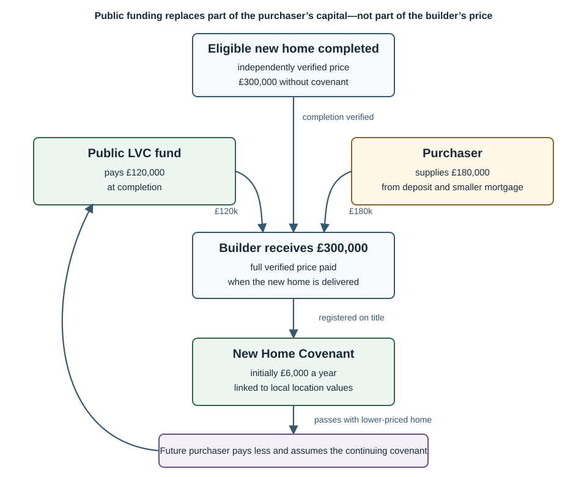

## Basic concept {#basic-concept}

A New Home Covenant would allow the purchaser of a newly completed home to replace part of the conventional purchase price and mortgage with a continuing Location Value Covenant.

The public LVC fund pays an agreed contribution towards the home at completion. The purchaser supplies the balance. The builder receives the full independently verified price, so the developer is not required to provide a discount or wait for covenant payments.

In exchange for the public contribution, an LVC is registered against the new home. The owner makes a continuing payment that is subsequently adjusted in line with relevant local location values. When the property is sold, the covenant remains attached to it and is reflected in the price paid by the next owner.

The defining feature is **additional housing supply**. The contribution is available only when an eligible new home is completed and added to the usable housing stock. This distinguishes the New Home Covenant from assistance that increases purchasing power for existing homes without increasing supply.

The basic exchange is:

**Smaller purchase balance and mortgage today ↔ a continuing covenant attached to the new home**

This is a policy proposal, not a currently available UK mortgage or home-purchase product.

## Worked example {#worked-example}

A builder completes a new home with an independently verified uncovenanted price of £300,000.

The purchaser chooses a £120,000 New Home Covenant contribution. At completion:

* The public LVC fund pays £120,000.
* The purchaser supplies £180,000 from their deposit and mortgage.
* The builder receives the full £300,000.
* A continuing covenant is registered against the property.

At an illustrative initial covenant rate of 5%, the opening payment is:

**£120,000 × 5% = £6,000 a year, or £500 a month**

| Transaction | Conventional purchase | New Home Covenant |
| --- | ---: | ---: |
| Builder receives | £300,000 | £300,000 |
| Public LVC contribution | £0 | £120,000 |
| Purchaser supplies | £300,000 | £180,000 |
| Initial covenant payment | £0 | £6,000 a year |

## How the LVC works {#how-it-works}

The purchaser does not receive £120,000 as freely spendable cash. It is paid into the property transaction and reduces the amount that the purchaser must provide.

### Effect on the mortgage 

Suppose the purchaser has a £60,000 deposit.

Without the covenant:

* Purchase price: £300,000;
* Deposit: £60,000; and
* Mortgage required: £240,000.

With the £120,000 covenant:

* Purchaser’s balance: £180,000;
* Deposit: £60,000;
* Mortgage required: £120,000; and
* Continuing covenant: initially £500 a month.

The buyer’s mortgage principal is therefore £120,000 lower. The covenant is not free and must be included in affordability calculations, but the household has much less conventional debt and less exposure to mortgage interest rates.

The exact monthly comparison depends on mortgage rates, repayment terms, covenant indexation and the length of ownership. The New Home Covenant should not be advertised as automatically cheaper over every possible lifetime.

## The beneficiaries {#beneficiaries}

* **Purchaser — why would I do this?** I can buy a newly built home with a much smaller mortgage and less exposure to interest-rate changes. I accept a continuing covenant and a lower future selling price.
* **Builder:** I receive the full verified price at completion and gain access to a wider pool of purchasers. I must meet eligibility, price-verification and completion requirements.
* **Government:** It connects home-purchase assistance to additional supply and acquires a continuing public revenue asset. It assumes financing, valuation, administration and programme-design risk.
* **Bank:** I provide a smaller, lower loan-to-value mortgage with a larger collateral buffer. I must include the covenant in affordability and value the property subject to it.
* **Future purchaser:** I buy the covenanted home for less and need less mortgage debt. I assume the continuing payment, which is reflected again when I later sell.
* **Wider community:** Additional construction can expand housing supply, employment and the local tax base. Those benefits depend on genuine additionality rather than relabelling planned development.

## Why might a purchaser choose it? 

The New Home Covenant can make a newly built home accessible with a smaller mortgage and potentially a smaller deposit requirement.

The purchaser may gain:

* A substantially lower conventional mortgage;
* Less mortgage interest over the loan term;
* Less exposure to refinancing at higher interest rates;
* A reduced risk of negative mortgage equity;
* A lower barrier to buying a newly built home; and
* A payment linked to local location values rather than a fixed debt principal.

In exchange, the purchaser accepts:

* A continuing payment that may rise or fall with the agreed index;
* A covenant that may continue after the mortgage has been repaid;
* A lower future selling price than the same home would command without the covenant; and
* The possibility that the covenant costs more or less than the displaced mortgage over a particular period.

The relevant choice is not between paying £300,000 and receiving £120,000 for nothing. It is between two ways of financing the same new home:

**Larger mortgage and no covenant ↔ smaller mortgage and a continuing covenant**

## Why might a builder participate? 

The builder receives the full £300,000 at completion in either case. The covenant does not require the builder to accept £180,000 for a £300,000 home.

Participation could benefit builders by:

* Increasing the number of purchasers able to afford a newly built home;
* Reducing dependence on very high loan-to-value mortgages;
* Supporting sales during periods when mortgage credit is tight;
* Increasing confidence that completed homes can be sold; and
* Helping schemes reach the sales rate needed to finance later construction phases.

The builder should receive no payment merely for labelling an existing property “eligible.” Public money is released only for a qualifying additional home, against verified completion and sale.

The independently verified price is essential. Without it, a developer could raise the headline price because public money is available, allowing the contribution to be captured as additional profit or land value rather than reducing the purchaser’s financing requirement.

## What happens when the home is sold? 

The covenant remains attached to the property. The first owner stops making the payment and the purchaser assumes it.

The future buyer did not receive the original £120,000 contribution, but receives its economic effect through the property’s lower covenanted price.

If an otherwise comparable uncovenanted home is worth £300,000, a buyer will not normally pay the same £300,000 for a home carrying a £500 monthly continuing obligation. The market capitalises the payment into a price discount.

The precise discount is not guaranteed to equal £120,000. It will depend on:

* The current covenant payment;
* Expected future indexation;
* Market discount and mortgage rates;
* Administration and enforcement risk;
* Availability of finance for covenanted properties; and
* Buyers’ preferences between upfront price and continuing payments.

The future buyer’s exchange is:

**Lower purchase price and smaller mortgage ↔ assumption of the continuing covenant**

When that buyer later sells, the same adjustment occurs again. The covenant and its price effect travel together through successive ownerships.

## Why might government support it? 

The public contribution is not necessarily an unrecoverable housing grant. Government acquires a legally enforceable, continuing revenue-producing asset attached to a newly created home.

The policy could:

* Connect home-purchase assistance directly to additional supply;
* Reduce the amount of new commercial-bank mortgage credit required;
* Help first-time buyers without giving them a one-off discount that disappears on resale;
* Create a long-term public revenue stream;
* Support construction through downturns; and
* Allow part of future location value to support public finances.

Government also bears real risks. It must finance the contribution upfront, value the covenant prudently, administer payments, manage arrears and ensure that developers do not capture the wider public value through higher prices or land bids.

The public asset should be valued as the discounted value of expected future net covenant payments, after allowing for financing costs, indexation, administration, non-payment and policy risk.

## Why might a bank participate? 

The purchaser may still need a conventional mortgage, but it is substantially smaller.

In the worked example, the bank lends £120,000 rather than £240,000. This can produce:

* A lower loan-to-value ratio;
* A larger buffer against property-price falls;
* Lower loss exposure if the borrower defaults; and
* A mortgage payment that is easier for the borrower to maintain.

The bank must include the covenant payment in its affordability assessment. Its security valuation must be the market value of the property **subject to the covenant**, not the £300,000 uncovenanted price paid to the builder.

A smaller loan is not automatically more profitable for the bank, but it should be less exposed to housing-market and borrower-default risk.

## Why tying support to new supply matters 

Housing assistance can raise prices when it gives buyers more spending power to compete for an unchanged stock of homes.

The New Home Covenant is intended to avoid that mistake by making eligibility conditional on an additional completed dwelling. Every public contribution accompanies another usable home entering the market.

This does not make price inflation impossible. If developers know that purchasers have access to public contributions, they or the original landowner may attempt to capture part of the wider public value through higher prices or land bids.

The programme should therefore test two kinds of additionality:

1. **Physical additionality:** the home must be genuinely new and added to the usable stock.
2. **Financial additionality:** the contribution must reduce the purchaser’s required capital rather than inflate the verified price, land value or developer margin.

Useful safeguards could include:

* Independent comparison with similar uncovenanted new and existing homes;
* Published build-cost, land-cost and margin information for supported schemes;
* Competitive allocation of programme capacity between developers;
* Payment only after completion and independent certification;
* Limits on purchases from connected parties;
* Clawback for misrepresentation or artificial price inflation; and
* Priority for projects that would not otherwise proceed at the same scale or speed.

## Where does the public money come from? 

The public LVC fund must supply £120,000 at completion before it has received years of covenant payments.

It could be financed through:

* Government borrowing, including gilts purchased by existing savers;
* Reinvestment of receipts from an established LVC portfolio;
* Public pension or institutional investment through government securities;
* Proceeds from public land; or
* A mixture of these sources.

The fund acquires the covenant asset in exchange. Its financial sustainability depends on whether expected net receipts justify the contribution and financing cost.

The contribution should be recorded transparently as the acquisition of a long-lived public financial asset, with any subsidy element reported separately. A covenant with an expected net value below the public payment may still be justified by additional housing or wider public value, but that difference is a public subsidy and should not be concealed as asset value.

## How is the initial covenant determined? 

The initial covenant follows from the contribution chosen under the programme and the applicable starting rate:

**Initial annual payment = public contribution × initial covenant rate**

In the example:

**£120,000 × 5% = £6,000 a year**

The system does not need to calculate the precise standalone land value beneath the individual home to establish that opening payment. The £120,000 contribution determines it.

Local land or rental values are then used to adjust the payment over time. The index should reflect changes in the location rather than changes caused solely by the owner’s later extensions, refurbishment or maintenance.

Ordinary property valuation remains essential for verifying the uncovenanted price, assessing the covenanted market value and protecting the purchaser and public fund. That is different from making the opening contribution a fixed percentage of a precise individual land valuation.

## Who should be eligible? 

Several models are possible.

### First-time buyers 

Restricting the initial programme to first-time buyers would target the largest deposit and mortgage-access problems. It would also provide a controlled route for testing affordability, valuation and resale.

The limitation is that a developer needs purchasers throughout the market. Excluding movers could reduce sales chains and the overall construction response.

### Tenants buying a new home 

Priority could be given to social or private tenants moving into ownership. Each successful purchase could release an existing rented home for another household.

The programme would need safeguards against selecting only higher-income tenants while leaving the supply of affordable rented housing unchanged.

### All purchasers of qualifying new homes 

Universal availability would be simplest and could generate the strongest supply response. It would also require the largest public financing capacity and create the greatest risk of contributions being capitalised into new-build land prices.

### Scheme-based allocation 

Government could allocate a fixed LVC funding envelope competitively to developments offering the best combination of:

* Additional homes;
* Lower verified purchaser prices;
* Infrastructure and environmental quality;
* Affordable and mixed-tenure provision;
* Delivery speed; and
* Public value for the covenant contribution.

This might control fiscal exposure more effectively than an unlimited entitlement.

## Could the covenant fund 100% of the home? 

In principle, the public contribution could cover the entire independently verified price. The builder would be paid in full, while the purchaser would acquire the home for little or no upfront capital and assume a much larger continuing covenant.

That would not be a free home. The covenant’s capitalised value could reduce the property’s cash resale price towards zero, and the owner would remain responsible for a substantial continuing payment.

A 100% New Home Covenant would create difficult questions:

* What financial stake does the purchaser have at inception?
* How are maintenance, abandonment and payment incentives protected?
* Can the property support any additional mortgage?
* What happens if the covenant becomes unaffordable?
* Would buyers prefer renting or a conventional mortgage to such a large permanent obligation?
* Would the covenant 'eating' into the value of the bricks and mortar cause problems?

A capped partial contribution is therefore a more credible starting design. Higher percentages could be tested only after a functioning resale, mortgage and arrears market exists.

## Effects on house prices and construction 

The immediate cash price of an LVC-funded home should be lower because the public contribution replaces part of the purchaser’s capital requirement. The full economic housing cost includes both that price and the covenant.

Across the wider market, the effect depends on supply:

* If the programme causes more homes to be built, it can relieve scarcity and reduce upward pressure on prices.
* If developers merely relabel homes that would have been built anyway, the supply benefit is small.
* If landowners capture expected contributions through higher land prices, public funding may increase land values rather than affordability.
* If mortgage lending falls by the amount of the LVC contribution, less newly created bank credit enters the property market.
* If purchasers borrow the same amount despite the contribution, the policy may increase total bidding power and become inflationary.

The programme should therefore measure mortgage debt displaced, homes genuinely added, purchaser prices, land prices, developer margins and construction rates—not merely the number of covenants issued.

## Consumer and public protections 

A New Home Covenant would require:

1. Independent verification that the home is newly completed, habitable and genuinely additional.
2. Independent valuation of the uncovenanted price and estimated covenanted market value.
3. Full disclosure of the current payment, index, expected price effect and possible lifetime cost.
4. An affordability assessment covering the mortgage, covenant, service charges, maintenance and other property costs.
5. Separate legal and financial advice for the purchaser.
6. Clear responsibility for defects, warranties and building-safety obligations.
7. Published rules for arrears, hardship, deferral, enforcement and any redemption right.
8. Mortgage-lender recognition and standard conveyancing documentation.
9. Controls preventing the public contribution from inflating prices, land values or connected-party transactions.
10. Public reporting of financing costs, covenant asset values, developer participation, additional homes and mortgage debt displaced.

## Policy effect {#policy-effect}

The New Home Covenant combines two objectives that are often pursued separately: helping households finance home ownership and increasing the supply of homes.

The purchaser obtains a lower-capital route into a newly built property. The builder receives the full verified price. The bank provides a smaller mortgage. Government acquires a continuing revenue asset rather than making a simple one-off grant. Future owners receive the lower covenanted price and assume the payment.

Its strongest systemic advantage is that LVC purchasing support is released only when another home enters the usable stock. This reduces—but does not eliminate—the risk that easier finance merely raises the price of existing housing.

The policy succeeds only when three outcomes occur together:

* A genuinely additional home is completed;
* The purchaser’s conventional mortgage or capital requirement is actually reduced; and
* The public receives a covenant asset whose value and wider value justifies the contribution.

If those tests are met, the New Home Covenant could provide a scalable way to fund new housing while gradually replacing part of mortgage debt with long-term, location-linked public revenue.
