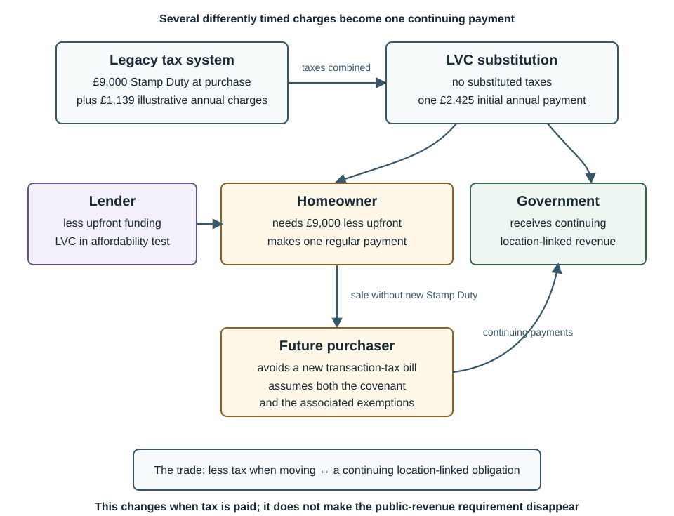

## Basic concept {#basic-concept}

Buying and occupying a home can involve several separate taxes and charges. Some are paid when the property is bought; others recur annually. They have different rules, collection systems and effects on household decisions.

Property Tax Substitution would replace selected charges with one continuing Location Value Covenant payment attached to the property. A participating property would become exempt from the taxes included in the substitution, and its owner would instead make the covenant payment.

The proposal is intended to:

* Remove or reduce the large upfront tax cost of moving home;
* Replace several liabilities with one visible regular payment;
* Link future changes in that payment to local location values; and
* Give government a continuing revenue stream without collecting so much tax at the moment a property changes hands.

The covenant does not eliminate the household’s contribution to public revenue. It changes the timing, structure and economic incentives of the taxes being replaced.

This is a policy proposal, not a currently available alternative to UK property taxes.

## Worked example {#worked-example}

The original briefing uses a Cambridge house and historical illustrative tax figures. Simon owns the house and is willing to sell it for £300,000. Under the legacy system, the purchaser also pays £9,000 Stamp Duty, so the home costs the purchaser £309,000 before other transaction costs.

The property also carries illustrative annual Council Tax of £1,000 and a £139 television licence. The proposal converts these charges into one annual covenant by spreading the £9,000 Stamp Duty across an assumed seven-year period of ownership:

**£9,000 ÷ 7 years = approximately £1,286 a year**

**£1,286 + £1,000 + £139 = approximately £2,425 a year**

Under the substitution, the buyer pays Simon £300,000, pays no Stamp Duty and accepts a £2,425 annual covenant. The participating property is then exempt from the charges included in the example.

| Initial and annual amounts | Legacy taxes | Covenant substitution |
| --- | ---: | ---: |
| Seller receives | £300,000 | £300,000 |
| Buyer’s Stamp Duty | £9,000 | £0 |
| Illustrative annual Council Tax | £1,000 | £0 |
| Illustrative annual TV licence | £139 | £0 |
| Initial annual covenant | £0 | £2,425 |

## How the LVC works {#how-it-works}

## The beneficiaries {#beneficiaries}

* **Homeowner or purchaser — why would I do this?** I avoid a large tax bill when I move and replace several charges with one regular payment. I need less cash at purchase and may need less borrowing. In exchange, I accept a continuing covenant whose cost depends on how long I own the property and how local values change.
* **Seller:** My buyer does not have to fund Stamp Duty on top of the price. That may widen the pool of potential buyers and make the property easier to sell without reducing the amount I receive in the original example.
* **Government:** It replaces volatile transaction-tax receipts and separate annual charges with a continuing revenue stream linked to local location values. The policy succeeds fiscally only if the covenant rate and exemptions are designed to preserve the intended revenue over time.
* **Bank or mortgage lender:** The purchaser needs less upfront cash or borrowing because Stamp Duty is removed. The lender can see one registered continuing payment, but must treat it as a committed household expense when assessing affordability.
* **Future purchaser:** I receive the tax exemptions attached to the participating property and avoid a new transaction-tax charge. In return, I take over the covenant and later pass both the obligation and exemptions to the next owner.

### What does the homeowner actually gain? 

The immediate benefit is easiest to see when moving home. The purchaser no longer needs to find the £9,000 Stamp Duty in addition to the purchase price. That can reduce the cash deposit and transaction funds required, or avoid adding the tax cost to other borrowing.

After purchase, the owner makes one £2,425 covenant payment instead of the substituted annual charges. The proposal therefore removes an upfront barrier to moving and spreads the revenue requirement over time.

The owner is not necessarily better off by exactly the same amount in every year. The example is designed to be broadly equivalent for somebody who owns the home for seven years:

* **Shorter ownership:** avoiding £9,000 upfront while paying the covenant for only a few years could be advantageous.
* **Seven-year ownership:** the example aims for approximate equivalence before indexation and financing effects.
* **Longer ownership:** the continuing covenant may eventually cost more than the one-off Stamp Duty that the owner avoided.

The benefit is therefore not simply “lower tax.” It is a different tax structure: less cost at the point of moving, a clearer regular liability and a payment that subsequently changes with local location values.

### Why can removing Stamp Duty help? 

Stamp Duty is triggered by a transaction. It makes moving more expensive even when a household has good reasons to move—for example, to take a job, downsize, form a new household or move closer to family.

A continuing property payment does not create the same new tax bill each time the home is sold. Removing that transaction penalty can make the housing market more liquid and allow homes to be used by households whose needs fit them better.

It may also reduce borrowing. In the example, the buyer needs £300,000 for the price rather than £309,000 for the price plus Stamp Duty. The seller still receives £300,000.

### What happens when the property is sold again? 

The covenant remains attached to the property. The seller stops paying it and the next purchaser assumes it.

That purchaser also receives the associated tax exemptions, including the absence of Stamp Duty if the scheme continues as proposed. The market price should reflect the overall package: the continuing covenant is a liability, while exemption from the substituted taxes is a benefit.

It is therefore too simple to say that the covenant must reduce the property price by its entire capitalised value. Buyers value the **net position**—the covenant payments they assume compared with the taxes and transaction costs they avoid. If the two are designed to be equivalent, their capital effects may substantially offset each other.

### What does a future purchaser receive? 

The future purchaser receives the same basic exchange as the first participant:

**No substituted transaction or annual taxes ↔ one continuing, location-linked payment**

They can move into the property without a new Stamp Duty bill and can identify the regular covenant before buying. Their lender can include that payment in the affordability assessment.

The arrangement must remain transparent. The purchaser should be shown the current payment, its indexation, the taxes from which the property is exempt and how the package compares with a non-participating property.

## Policy effect {#policy-effect}

Property Tax Substitution shifts taxation away from property transactions and towards a continuing payment associated with the property’s location.

Its main potential advantage is mobility: a household can move without incurring a fresh large transaction-tax bill. It may also reduce the cash and debt required at purchase, make continuing property liabilities more visible and give government a less transaction-dependent revenue stream.

The reform is a substitution, not a free tax reduction. Its fairness depends on the starting payment, the local index, the taxes and exemptions replaced, length of ownership and treatment of households with different circumstances.

The proposal could operate alongside other Location Value Covenant applications, including the Homeowner Pension, provided each covenant and exemption is separately disclosed and the combined payments remain affordable.

### Why precise land value is not required 

The initial covenant is calculated from the taxes and charges being replaced, not by separately valuing the land beneath the house.

In the example, the starting £2,425 payment comes from:

* Annualised Stamp Duty of approximately £1,286;
* Council Tax of £1,000; and
* A television licence of £139.

Local land or rental values are then used as an index to adjust the payment over time. The scheme therefore needs a reliable local index, but not a detailed valuation of every physical characteristic of the individual plot merely to establish the opening payment.

Ordinary property valuation still matters when buyers, sellers and lenders assess the overall package. That is different from requiring a precise standalone land valuation to calculate the covenant.

### What the comparison does—and does not—show 

The £2,425 figure is arithmetically correct on the original assumptions, but it is not proof that every participant would pay exactly the same tax under both systems.

Stamp Duty is a one-off transaction tax, Council Tax is generally an occupier liability, and a television licence depends on how television services are used rather than on property ownership. Each also has exemptions, discounts and enforcement rules. A single property covenant would redistribute liabilities between people who move frequently and rarely, between different kinds of household and potentially between owners and occupiers.

The historical figures should therefore be read as an explanation of the mechanism, not as a current UK tax quotation or a completed revenue-neutral rate calculation. Any present-day version would need to specify exactly which taxes are replaced and recalculate the covenant using current revenues, tax bases and distributional effects.

## Combining more than one LVC {#homeowner-pension-combination}

Property Tax Substitution is fully compatible with the Homeowner Pension and may be advantageous whenever a Homeowner Pension is created.

A Homeowner Pension already requires government and the homeowner to establish a covenant, value its effects, register it against the property and arrange continuing collection. Adding Property Tax Substitution at the same time could use much of the same legal and administrative process.

The property would then carry two identifiable components:

* **A Homeowner Pension covenant**, created in exchange for additional lifetime income paid to the original homeowner; and
* **A Property Tax Substitution covenant**, replacing the specified taxes and charges.

The two amounts could appear as one collected payment, but should remain separately recorded. Combining them into a single unexplained figure would make it difficult to distinguish the cost of releasing housing wealth from the taxes being replaced.

### How the combined arrangement could work 

When a homeowner enters the Homeowner Pension scheme:

1. Government grants the homeowner an additional lifetime income.
2. The property becomes subject to the corresponding Homeowner Pension covenant.
3. Selected property taxes and charges are simultaneously replaced by a separate tax-substitution component.
4. The homeowner receives one statement showing the gross pension, both covenant components and every tax exemption.
5. Both covenant components remain attached to the property when ownership changes.

While the original homeowner remains in the property, the Property Tax Substitution component replaces charges they would otherwise pay separately. It should therefore be assessed against the taxes removed, rather than presented simply as a further deduction from their pension.

### Why combine them? 

The combined approach could provide several advantages:

* **For the homeowner:** one application, one legal process and one comprehensible account can provide additional income while replacing several separate property charges.
* **For government:** each new Homeowner Pension can also bring another property into the reformed property-tax system, allowing gradual adoption without requiring every property to convert on the same day.
* **For administration:** valuation, registration, indexation, collection and enforcement systems can be shared.
* **For a future purchaser:** the property’s continuing obligations and corresponding benefits are disclosed together before purchase.
* **For the wider housing market:** future sales can occur without a new substituted transaction-tax bill, while the public revenue stream continues through the covenant.

### Protecting the homeowner’s additional income 

The combination must not obscure the purpose of the Homeowner Pension, which is to leave the homeowner with additional spendable income.

If Property Tax Substitution merely replaces annual charges already paid by the homeowner, its payment can be compared directly with the bills removed. However, a component representing avoided Stamp Duty is different: the current homeowner may not receive that benefit until the property is sold, and it may principally benefit the purchaser.

A combined scheme could address this by:

* Substituting the homeowner’s recurring annual charges when the pension begins and adding the transaction-tax component at the next sale;
* Recognising the value of the future Stamp Duty exemption in the property’s sale price; or
* Calculating the gross pension and combined covenant so that the homeowner retains the intended net income after all substituted charges are considered.

The homeowner should receive a before-and-after illustration showing:

* Existing income and property charges;
* Gross Homeowner Pension income;
* The Homeowner Pension covenant;
* The Property Tax Substitution covenant;
* Taxes and charges removed; and
* The resulting change in spendable monthly income.

### Position of a future purchaser 

A future purchaser does not receive the original homeowner’s pension. Their benefits instead arise through the property:

* A lower purchase price reflecting the Homeowner Pension covenant;
* No liability for the taxes replaced by Property Tax Substitution; and
* Less upfront cash or mortgage borrowing if Stamp Duty has been removed.

In return, the purchaser assumes both continuing covenant components. When they later sell, the next purchaser receives the same associated price adjustment and tax exemptions.

The combined arrangement therefore remains an exchange rather than a free benefit:

**Additional income for the original homeowner and tax exemptions for successive owners ↔ continuing payments attached to the property**

Used together, the two applications could provide a practical route for introducing Property Tax Substitution property by property. The pension and tax components should nevertheless remain independently calculated, disclosed and reviewable.
