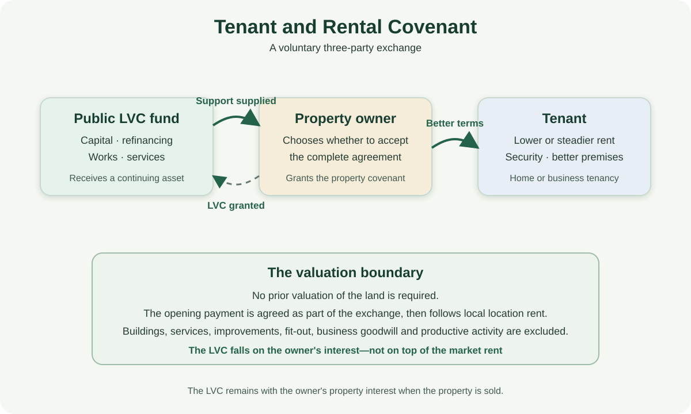

## Basic concept {#basic-concept}

Tenants occupy homes and business premises but do not normally own the property interest to which a Location Value Covenant would attach. They should not be able to impose a covenant upon an unwilling owner. Equally, public support should not enrich a landlord while leaving the tenant paying the same rent on the same terms.

The Tenant and Rental Covenant resolves this through a voluntary three-party exchange. A property owner chooses to receive capital, refinancing, works or services from a public LVC fund. In return, the owner grants an LVC over the property and gives the tenant a defined contractual advantage. That advantage might be a lower or more predictable rent, a longer tenancy, improved premises, protection for tenant-funded improvements, or a first opportunity to buy if the owner later decides to sell.

The tenant does not force the owner into the arrangement. The public offer makes participation worthwhile to the owner, while participation is conditional upon a material and enforceable improvement in the tenant's position.

There would be three closely related routes:

| Route | What is supplied | What the tenant receives |
| --- | --- | --- |
| **Residential Rental Covenant** | Capital, refinancing, improvements or new housing supply | Lower or more predictable rent, better conditions, or greater security |
| **Commercial Rental Covenant** | Premises investment, refinancing, fit-out support or regeneration works | Lower occupancy costs, a longer lease, improved premises, or protection for business investment |
| **Tenant Purchase Covenant** | Part of the consideration needed to buy | A smaller conventional mortgage and a disclosed LVC attached to the acquired property |

The purchase route complements the tenant-purchase provision in Application 07. The distinctive purpose of this application is to help people and businesses **while they remain tenants**, not merely to turn them into owners.

### No prior land valuation

The agreement would not begin by trying to calculate the property's uncovenanted land value. The parties would identify the capital, works or services being supplied, the tenant commitment being offered, and the initial LVC payment that makes the whole exchange acceptable.

The initial payment is therefore an express term of the voluntary bargain. Once established, it can change according to a published index of comparable local location rents. Buildings, maintenance, services, landlord-funded improvements, tenant-funded fit-out and business goodwill remain outside the LVC assessment.

This avoids pretending that land and buildings can always be separated precisely before the covenant exists. Market evidence becomes especially useful afterwards: sales and lettings of covenanted and uncovenanted properties reveal how purchasers and tenants price the obligation in practice.

This is a policy proposal, not a currently available tenancy, finance or property product. Detailed legal, tax, lending and consumer-protection rules would be required.

## Worked example {#worked-example}

### Residential tenant

Assume a landlord owns a rented home subject to a £180,000 mortgage. The landlord and tenant agree that greater rent stability and energy improvements would make the tenancy more sustainable. A public LVC fund offers £60,000: £45,000 is used to reduce the mortgage and £15,000 pays for insulation, ventilation and heating improvements.

In exchange:

* The owner grants an LVC with an illustrative opening payment of £2,400 a year;
* The tenant receives a five-year tenancy, subject to defined statutory and contractual grounds for possession;
* The rent is reduced by £150 a month and follows an agreed review formula during the protected period.

| Residential position | Before agreement | After agreement |
| --- | ---: | ---: |
| Landlord's conventional mortgage | £180,000 | £135,000 |
| Illustrative monthly mortgage cost at 5% interest-only | £750 | £562.50 |
| Tenant's monthly rent | £1,200 | £1,050 |
| Initial annual LVC paid by owner | £0 | £2,400 |
| Tenancy commitment | Existing terms | Five-year protected term |

These figures do not prescribe the split. They show how cheaper or patient public capital could create enough value for the landlord to accept both a covenant and better tenancy terms. The agreement should be approved only where the tenant receives a substantial share of the value supplied.

### Commercial tenant

Assume a small manufacturer occupies premises on a short lease and needs £120,000 of electrical, access and workshop improvements. The landlord is unwilling to finance all of the works, while the tenant will not invest heavily without longer security.

The public fund supplies the approved works in exchange for an LVC over the owner's property. The landlord grants the business a ten-year lease with a defined rent-review formula and provisions protecting the tenant's removable equipment and separately funded fit-out. The initial LVC payment is agreed at £4,800 a year and remains the owner's property obligation.

The landlord obtains improved, financeable premises; the tenant can invest and employ with greater certainty; and government acquires a continuing revenue asset. The LVC does not increase merely because the tenant's business becomes more successful.

## How the LVC works {#how-it-works}

### The voluntary offer

1. A landlord, tenant or public body identifies a tenancy problem or property investment that could be resolved through an LVC agreement.
2. The public fund defines the capital, refinancing, works or services it is willing to supply.
3. The landlord states the tenancy commitment it is prepared to give and the initial LVC payment it will accept.
4. The tenant receives the complete proposed terms and independent information before agreeing to any change in the tenancy.
5. If all parties consent, the LVC is registered against the owner's property interest and the tenant protections are recorded in an enforceable lease or tenancy agreement.
6. The public contribution is released only when both parts of the exchange are effective.

Neither the tenant nor government compels the owner to grant an LVC. The owner remains free to reject the offer. The tenant should likewise remain free to reject a proposed tenancy variation; refusal must not remove existing statutory or contractual rights.

### Setting the payment without valuing the land first

The initial LVC payment would be negotiated and independently checked as part of the package. Its adequacy would be assessed from the value and cost of what government supplies, the expected payment stream, indexation, duration, administration, risk and the tenant commitment obtained.

No calculation of a residual or hypothetical bare-land value is required before agreement. Government is valuing the covenant it will receive, not attempting to discover and confiscate a pre-existing land value.

After the opening payment is fixed, changes would follow a suitable local location-rent index. The index should use comparable market evidence and published methods. It must exclude changes attributable to:

* The building and its physical condition;
* Repairs, maintenance and management services;
* Improvements financed by the landlord outside the public agreement;
* Improvements, equipment and fit-out financed by the tenant;
* The tenant's trading success, customer base and goodwill; and
* Personal income, turnover, profit or productivity.

The payment may rise when the underlying location becomes more valuable, even if the public fund ultimately captures a very high proportion of that location rent. Value created by buildings, improvements, work and enterprise remains with those who created it.

### Economic incidence and the tenant's consideration

An LVC cannot simply be passed through to tenants. A landlord already seeks the highest total rent the market will bear. Renaming part of that rent as an LVC charge does not increase what tenants are willing or able to pay. The covenant therefore falls upon the owner's economic interest and is reflected in the capital value of the property, not added on top of the market rent.

The tenant's improvement under this application has a different source. It is part of the consideration that government purchases when it supplies capital, refinancing, works or services to the landlord. The agreement should specify that consideration—such as a rent reduction, a defined review path, a longer tenancy or better premises—so that the public contribution does not become an unearned transfer to the owner.

For commercial property, the agreement should distinguish the rent from service costs, turnover arrangements and tenant improvements. Compliance should be auditable, and material breach should permit enforcement or recovery of the public contribution. This does not require rents to be frozen forever. It requires the landlord's promised consideration to be real, measurable and durable enough to justify the support received.

### Sale, renewal and purchase

The LVC remains attached when the property is sold. A purchaser sees the obligation before buying, pays a price reflecting it and assumes the future payments. The tenant's protected term and other registered or contractual rights continue according to the agreement and general law.

A covenant could include a right of first refusal or purchase option, but only if the owner volunteers that term. If the tenant later buys, the purchase price should reflect the continuing LVC. The tenant does not pay an uncovenanted price and then inherit an undisclosed obligation.

For a block, shopping parade or multi-let building, the property owner could grant one LVC while the agreement allocates the purchased tenancy improvements across the affected units. Ordinary market competition would still determine the total rent obtainable from those units.

### New rental supply

The mechanism could also be agreed before construction. A developer or long-term landlord could receive land acquisition funding, infrastructure or other capital in exchange for an LVC and a published schedule of initial rents and tenancy terms.

This may be the cleanest form of the application: the lower conventional financing requirement is built into the project from the start, tenants enter with full knowledge of the terms, and no existing tenancy needs to be rewritten.

## The beneficiaries {#beneficiaries}

* **Residential tenant — why would I support this?** I remain a tenant but receive a concrete improvement such as lower or more predictable rent, a longer secure term or a better home. I do not acquire the landlord's LVC as a separate personal debt.
* **Commercial tenant:** I can invest in premises, equipment and employment with more confidence because occupancy costs and lease terms are clearer. My fit-out, goodwill and business success are not included in the LVC.
* **Landlord:** I voluntarily obtain capital, cheaper refinancing, improvements or support for new construction. In exchange, I accept a continuing property payment and provide better tenant terms.
* **Government:** It acquires an enforceable, location-linked revenue asset rather than making an unrecoverable landlord grant. Its contribution must produce both an adequately valued covenant and the contracted tenant outcome.
* **Lender:** Conventional property debt may be reduced and the premises improved. The LVC and tenant commitments must be disclosed and reflected in affordability, priority and security valuation.
* **Future purchaser:** I buy with full knowledge of the covenant and tenancy terms. The price can reflect both rather than concealing them until after purchase.
* **Wider community:** More stable homes and business premises can reduce displacement, support local employment and allow investment to continue without taxing the tenant's productive activity.

The landlord is not compelled to participate, and the tenant is not treated as an afterthought. Each party gives and receives something identifiable.

## Policy effect {#policy-effect}

Tenant policy often alternates between controlling landlords and subsidising tenants. Controls can reduce supply or investment if badly designed, while unrestricted demand subsidies can be absorbed into rents. A Tenant and Rental Covenant offers a different approach: government supplies something of value only through a negotiated property agreement that secures a continuing public return and a defined tenant outcome.

The LVC itself does not raise the market rent. Tenants are already paying what competition for the available premises allows them to pay. Its immediate incidence is upon the owner's return and the capital price of the covenanted property. Over time, the stronger tenant effect should come from the other side of the policy: financing more homes and business premises, improving marginal locations and removing taxes on construction, employment and enterprise. Greater and better supply gives tenants more alternatives and relieves pressure on rents in the more valuable centres.

The application also helps keep the wider LVC programme economically coherent. Public revenue comes from the location-linked covenant rather than an additional tax on the tenant's wages, trade, investment or employment. The landlord retains the return from buildings and genuine improvements. The tenant retains the value created by personal work, business capital and goodwill.

Residential and commercial tenants require different standard agreements, indices and protections, but the governing principle is the same:

**No compulsion, no prior land valuation, no unearned landlord transfer and no tax on tenant-created value.**

Application 07 remains the appropriate home for the tenant-purchase route. This application fills the larger gap by improving the position of households and businesses that continue to rent.

The proposal would require legislation and standard contractual rules covering registration, lender priority, rent reviews, service charges, possession, lease renewal, multi-let buildings, tenant improvements, default, sale and enforcement. It should be independently advised, transparent to all parties and tested through voluntary pilots before wider use.
