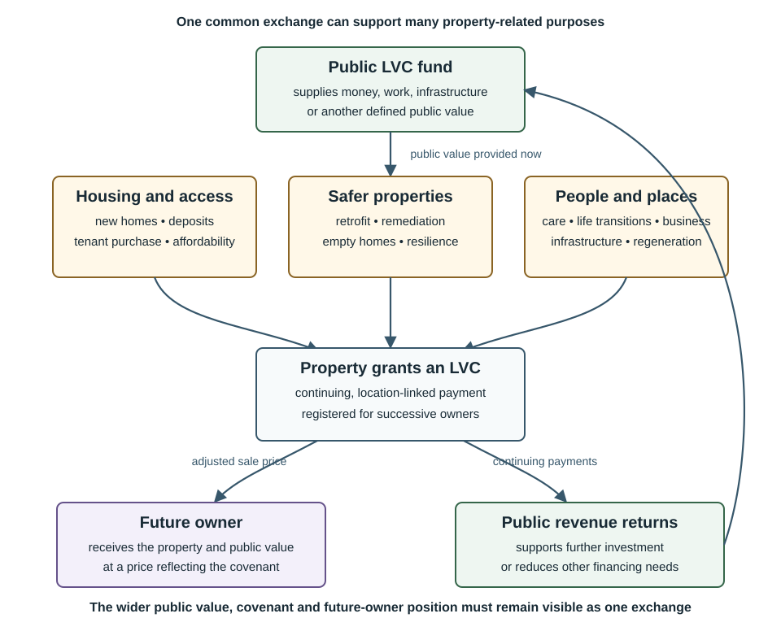

## Basic concept {#basic-concept}

Location Value Covenants can do more than help purchase a home, rescue a mortgage, provide retirement income or settle a tax liability.

The same mechanism can support a wider range of public purposes whenever four elements are present:

1. A property owner or purchaser receives defined capital, works, services or liability settlement.
2. Government or a public LVC fund supplies something with an identifiable value and cost.
3. A continuing payment is attached to the property as consideration.
4. Future owners receive the property at a price reflecting the covenant and assume its continuing payment.
The underlying exchange is:

**Property-related value supplied now ↔ a continuing location-linked payment attached to the property**

Government does not necessarily make an unrecoverable grant. It acquires a legally enforceable revenue-producing asset. The recipient does not receive free money: the property assumes a continuing obligation that affects its future market price.

This framework could encompass new housing, property improvement, conservation, business investment, local infrastructure and assistance during major household transitions.

These are policy proposals, not currently available UK financial products or alternatives to regulated advice.

## How the common mechanism works {#how-it-works}

The precise wider public value differs between applications, but the financial sequence is broadly the same:

1. The public fund assesses the proposed expenditure and the wider public value connected to the property.
2. The owner or purchaser receives an agreed contribution, service or liability settlement.
3. An LVC is registered against the property.
4. The initial covenant payment is calculated from the value supplied and the programme’s published valuation assumptions.
5. The payment is subsequently adjusted using an appropriate local location-value index.
6. On sale, the covenant passes to the purchaser and is reflected in the price.
7. Continuing payments return to the public fund and can support further investment, reduce borrowing or replace other taxes.

The covenant should remain distinct from an ordinary loan. It has no conventional principal balance that is gradually repaid to zero. Unless the scheme provides a redemption mechanism, the payment continues after the original recipient has sold the property and after any accompanying mortgage has ended.

## Housing creation and access {#housing-access}

### LVC-funded new homes {#new-homes}

The strongest wider application may be financing part of the price of newly constructed homes.

#### Worked example 

Suppose a builder completes a home for which the agreed market price without a covenant is £300,000. A public LVC fund contributes £120,000 and the purchaser supplies the remaining £180,000.

| New-home transaction | Amount |
| --- | ---: |
| Builder receives | £300,000 |
| Public LVC contribution | £120,000 |
| Purchaser supplies | £180,000 |
| Illustrative initial covenant at 5% | £6,000 a year |

The builder still receives the full £300,000, so the policy does not require the developer to absorb the purchaser’s financing wider public value. The buyer needs £120,000 less purchase capital and potentially a much smaller mortgage. In exchange, the property carries the continuing covenant.

This is particularly attractive because the funding is connected to additional housing supply. Assistance that merely increases buyers’ spending power for the existing stock can be capitalised into higher prices. Tying the contribution to newly completed homes helps match additional purchasing capacity with additional supply.

### First-home deposit replacement {#deposit-replacement}

An LVC contribution could replace some or all of the deposit and high loan-to-value borrowing required by a first-time buyer.

The purchaser would gain earlier access to ownership without waiting many years to accumulate a large deposit. Government would acquire a continuing asset rather than guaranteeing a highly leveraged private mortgage or making a non-recoverable grant.

This is closely related to the Location Value Mortgage and should use the same valuation and affordability rules. It is best understood as a targeted route into that application rather than a completely different financial instrument.

### Social tenants purchasing their homes {#tenant-purchase}

A social landlord could transfer a home for a reduced cash price plus an LVC instead of granting a large outright Right to Buy discount.

The tenant would obtain a more affordable route into ownership. The public sector would retain a permanent revenue interest rather than simply surrendering part of the property’s value.

To avoid depleting social housing, receipts and public contributions could be reserved for replacement homes. Alternatively, the programme could be limited to new supply or properties that the landlord had already decided to sell.

### Preserving affordable housing {#affordable-housing}

LVC funding could reduce the initial price of designated affordable homes while keeping the public contribution attached to the property across successive sales.

Unlike a subsidy captured entirely by the first purchaser, a continuing covenant and resale framework could preserve the distinction between the lower cash price and the property’s uncovenanted value. The design would need to avoid duplicating or conflicting with existing shared-ownership, planning-obligation and resale-restriction arrangements.

## Improvement, safety and resilience {#improvement-resilience}

### Home improvement and energy retrofit {#retrofit}

The public fund could pay for approved work such as:

* Insulation and energy-efficiency improvements;
* Heat pumps, solar panels and energy storage;
* Adaptations for disability or reduced mobility;
* Water-efficiency measures; or
* Structural work required to extend the useful life of the home.

For example, government might fund £30,000 of approved work in exchange for an illustrative initial covenant of £1,500 a year at a 5% initial rate.

The owner receives the improvement without taking a £30,000 conventional loan. Government receives a continuing revenue asset. A future purchaser assumes the covenant but receives the safer, more efficient or more usable property.

The work must offer a genuine wider public value. The covenant may reduce the property’s price, while the improvement may increase its condition, usefulness or value. The owner and future purchaser should be shown the expected net effect rather than either side in isolation.

### Building-safety remediation {#building-safety}

An LVC could fund essential cladding removal, fire-safety work or structural remediation where the cost cannot be recovered fully from the developer, freeholder, insurer or another responsible party.

This could be preferable to leaving homes unsafe, bankrupting innocent leaseholders or creating conventional debts that prevent sale and remortgaging.

The covenant should fund only the legitimate residual cost. It must not allow parties responsible for defective work to transfer their liabilities to residents or government.

In multi-unit buildings, the covenant would need to be allocated fairly between the freehold, common parts and individual dwellings. Leasehold law, mortgage-lender consent and existing service-charge obligations would require careful integration.

### Empty and derelict homes {#empty-homes}

Councils could finance the restoration of long-term empty or uninhabitable homes in exchange for an LVC.

The owner would receive renovation capital without a conventional secured loan. The community would gain an occupied home, improved surroundings and a restored tax base. Government would receive a continuing payment rather than making an unrecoverable renovation grant.

Eligibility should require verified additional occupancy or substantial remediation. Otherwise public finance could subsidise work that the owner would have undertaken without assistance.

### Flood and conservation resilience {#flood-resilience}

The public fund could pay for flood doors, raised services, drainage, heat protection or other measures that make vulnerable properties safer and more insurable.

The strongest case arises where preventive investment costs less than repeated emergency assistance and uninsured damage. The covenant payment and expected avoided public losses should be evaluated separately, so that wider public wider public values are not mistaken for the financial value of the covenant itself.

## Support through major life events {#life-events}

### Residential social care {#social-care}

An older or disabled homeowner may need care while possessing substantial housing wealth but limited cash income. Government could fund eligible care costs in exchange for an LVC rather than requiring an immediate home sale or allowing a conventional deferred-payment debt to accumulate with interest.

The resident receives care rather than cash. The property assumes the continuing payment. When it is eventually sold, the purchaser pays a lower price reflecting the covenant and becomes responsible for it.

This is related to the Homeowner Pension because both convert part of housing wealth into a present personal wider public value. The principal difference is that the wider public value is an approved care service rather than freely spendable income.

### Council-tax and secured-debt arrears {#arrears}

Where a viable household faces enforcement or forced sale because property-related public debts have accumulated, a carefully limited LVC could settle the arrears.

The immediate wider public value would be removal of the enforcement threat and consolidation of the liability into a property-linked payment. The public sector would exchange an uncertain or expensive debt-recovery process for a continuing asset.

This should not become a routine method for avoiding current payments. It would be most defensible where the household can meet its future obligations, independent advice confirms that the exchange is preferable and enforcement would create a disproportionate public and personal loss.

### Divorce and separation {#separation}

Following separation, one partner may be unable to refinance the mortgage and release the other partner’s equity while retaining the family home.

An LVC contribution could provide part of the required capital. The departing partner receives the agreed settlement, the resident partner requires a smaller replacement mortgage and children may avoid an unnecessary move.

In exchange, the property carries a continuing covenant and has a lower future sale price. This is essentially a specialised Location Value Mortgage and should be compared with sale, private refinancing and other family-law arrangements.

### Farming and agricultural succession

Agricultural succession and farm investment require specialised treatment because agricultural location value must be separated from buildings, machinery, livestock, crops, drainage, soil improvements and the farming business.

The [Family Farm Covenant](/applications/family-farm-covenant/) considers two dedicated routes: settling an inheritance-tax or family-succession liability without breaking up a viable farm, and supplying long-term capital for productive agricultural investment.

## Business, infrastructure and regeneration {#business-infrastructure}

### Business premises {#business-premises}

A small or growing business could use an LVC contribution to acquire premises with a smaller commercial mortgage.

The vendor receives the full agreed price. The business retains more capital for equipment, employees and expansion. Government acquires a continuing revenue asset linked to the premises. A future purchaser pays less for the covenanted property and assumes the payment.

This application could redirect some financing away from passive property debt and towards productive business activity. It would still expose the business to a continuing property cost, and the covenant would need to be included in insolvency, refinancing and lease calculations.

### Local infrastructure {#infrastructure}

LVCs could help finance infrastructure that provides identifiable wider public values to participating properties, including:

* Transport connections;
* Local roads and utilities;
* Schools and community facilities;
* Parks and public-realm improvements;
* Flood defences; or
* Town-centre regeneration.

Owners might voluntarily grant a covenant in exchange for a direct connection, improvement contribution, tax reduction or another defined wider public value. As local accessibility and desirability changed, payments would follow the agreed local location-value index.

This differs from imposing a general land-value tax after public investment has occurred. The LVC rests on a defined voluntary exchange. The wider public value offered to each participating owner must therefore be sufficiently clear to support that agreement.

Area-wide infrastructure would also gove wider public value to non-participating properties. Government would need to decide how general taxation, developer contributions and voluntary covenants should share costs without giving free riders an unfair advantage. But this added public vlaue will be reflected in higher land value indexes anyway so the more widey LVC's get adotped the less this is an issue.

## What is in it for each participant? {#beneficiaries}

* **Property owner or purchaser — why would I do this?** I receive a home, improvement, service, liability settlement or other substantial wider public value without finding the entire cost immediately or taking an equivalent conventional loan. I accept a continuing payment and a corresponding effect on the property’s future selling price.
* **Future purchaser:** I pay a price that reflects the covenant and receive the improved property or the wider public value. I assume the continuing payment and pass it to the next owner when I sell.
* **Government or public fund:** It advances money or provides a valuable wider public value while acquiring a continuing revenue-producing asset. The transaction is worthwhile only if the covenant’s expected net value and any separately measured public wider public values justify the cost and risk.
* **Bank or mortgage lender:** The borrower may need less conventional debt and present a lower loan-to-value risk. The lender must nevertheless include every covenant in affordability and security valuations.
* **Builder, contractor or service provider:** It receives payment when the home, improvement or service is delivered rather than waiting for covenant receipts over many years.
* **Wider community:** It may gain additional homes, safer buildings, improved infrastructure, stronger businesses or reduced crisis expenditure. These wider public values should be assessed separately from the covenant’s financial value.

## The test for a suitable LVC application {#suitability-test}

Not every desirable public expenditure should produce a permanent property covenant. A proposal is a strong candidate only where:

1. The recipient obtains a clear, substantial and property-related wider public value.
2. The public contribution and covenant can be valued transparently.
3. The property can reasonably carry the payment without becoming unsaleable or unaffordable.
4. A future purchaser receives a lower price or continuing wider public value in exchange for assuming the obligation.
5. The local index is relevant to the property and can be independently administered.
6. The arrangement is better for the recipient and public than a grant, tax adjustment, conventional loan or existing legal remedy.
7. The scheme does not excuse a developer, insurer, lender or other responsible party from an existing liability.
8. The covenant does not charge owners for value created solely by their own later improvements.

Where these conditions are absent, an LVC can become merely a complicated permanent charge rather than a useful exchange.

## Valuation and combined covenants {#valuation}

The initial payment should be derived from the value supplied under the particular programme, not from an assumption that every application requires a precise standalone valuation of the land beneath the property.

The public asset is the discounted value of expected future net covenant payments. Valuation should allow for financing costs, indexation, administration, arrears, enforcement, uncertainty and any right of redemption.

A property might acquire more than one LVC over time—for example, a Location Value Mortgage followed by a retrofit covenant and later a Homeowner Pension. The components could be collected together, but each should remain separately identified and valued.

Before adding another covenant, the combined payment must pass a new affordability assessment. The homeowner and any future purchaser should see:

* The purpose and current amount of every component;
* How each component changes over time;
* The wider public value originally supplied;
* Any wider public value or exemption that continues for future owners;
* The combined effect on market value; and
* Whether any component can be reduced or redeemed.

## Policy effect {#policy-effect}

Wider Property Investment and Support would turn the LVC from a housing-finance instrument into a general framework for property-related public investment.

It could increase housing supply, reduce reliance on conventional secured debt, improve buildings, finance resilience, preserve viable homes and businesses through difficult transitions and help communities fund infrastructure.

The framework’s discipline is as important as its flexibility. Every application must identify the actual wider public value, the public cost, the covenant asset acquired and the position of future owners. Wider public value can strengthen the case for intervention, but they should not be silently added to the covenant’s accounting value.

Used selectively, the approach could replace some grants, guarantees and secured loans with assets that continue producing public revenue. Used indiscriminately, it could burden properties with overlapping permanent charges. The purpose of a common framework is to make that distinction visible before any covenant is created.
