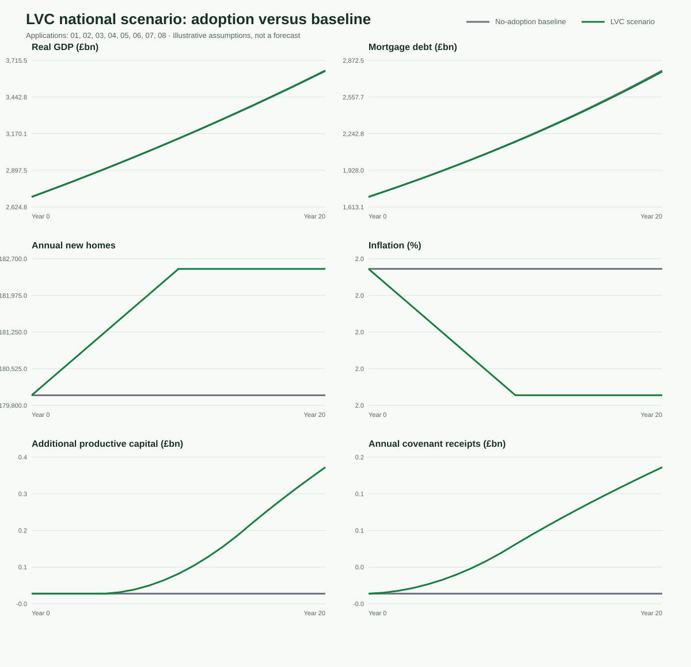
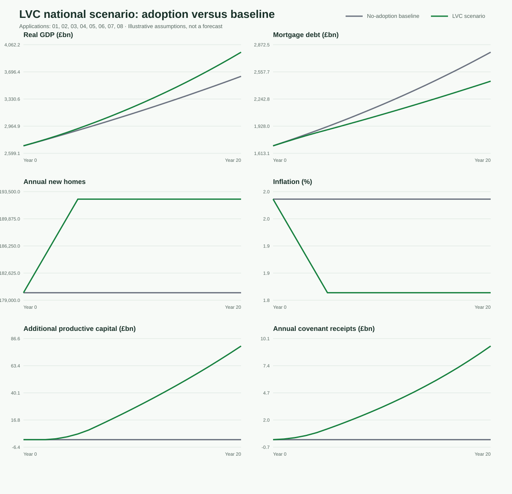

## The question this model asks {#question}

What might change if Location Value Covenants were adopted gradually across the country?

The model compares two paths over 20 years. The **baseline** assumes that LVCs are not introduced. The **LVC path** applies all eight proposed applications, from the Location Value Mortgage to New Home Covenants, wider property investment and monetary stability.

This is a scenario tool, not an official forecast. It shows the consequences of the assumptions entered. It does not prove that those assumptions will occur.

## Three possible scenarios {#scenarios}

The scenarios deliberately range from cautious adoption to a favourable case. The average scenario is the central illustration, not a prediction.

| Assumption | Conservative | Average | Best case |
| --- | ---: | ---: | ---: |
| Eventual take-up | 10% | 25% | 50% |
| Time to reach take-up | 10 years | 8 years | 5 years |
| Annual funding capacity at full take-up | £10bn | £25bn | £50bn |
| Annual funding growth | 1% | 2% | 3% |
| Average mortgage rate | 3.5% | 4.5% | 5.5% |
| Public funding cost | 4.0% | 3.5% | 2.5% |
| Household cash-flow spent in the economy | 40% | 60% | 75% |
| Displacement of the gross GDP effect | 30% | 15% | 5% |

All three runs assume starting GDP of £2.7 trillion at today's prices, starting mortgage debt of £1.7 trillion, baseline real GDP growth of 1.5%, baseline mortgage-credit growth of 2.5%, inflation of 2% and 180,000 new homes a year without LVCs.

## Conservative scenario {#conservative}

With slow take-up and restricted funding, the estimated effects remain modest. By year 20, GDP is £3.6bn higher than the baseline, mortgage debt is £9.3bn lower, annual new-home output is 2,500 higher and cumulative additional homes reach 38,750.

This run is useful as a test of whether the policy still makes a difference when adoption is limited and costs are relatively high.

## Average scenario {#average}

With take-up reaching 25%, GDP is £35.2bn higher than the baseline in year 20. Mortgage debt is £69.3bn lower, annual new-home output is 6,250 higher and cumulative additional homes reach 103,125.

In year 20, the model calculates £1.94bn of mortgage interest avoided and £1.24bn of covenant payments. The resulting net household cash-flow improvement is about £0.70bn for that year, of which £0.42bn is assumed to return to the economy through household spending.

## Best-case scenario {#best-case}

This is a favourable upper scenario rather than a forecast. Take-up reaches 50%, funding expands more quickly, mortgage rates are higher than the public funding cost, and little investment is assumed to be displaced.

By year 20, GDP is £211.6bn higher than the baseline, mortgage debt is £336.0bn lower, annual new-home output is 12,500 higher and cumulative additional homes reach 225,000. The estimated inflation rate is 0.15 percentage points below the baseline.

The large GDP result depends heavily on favourable assumptions. It should be read as an indication of what would have to go right, not what must happen.

## What produces the changes? {#method}

The model works through five main channels:

1. **Mortgage substitution.** LVC funding replaces part of the mortgage credit that would otherwise be created by commercial banks.
2. **Household cash flow.** Households avoid mortgage interest but make continuing covenant payments. The difference is the estimated household cash-flow change.
3. **Spending.** A selected proportion of that household cash-flow change is assumed to be spent in the wider economy.
4. **Housing and investment.** New homes, infrastructure and regeneration create direct economic activity. The model deducts an assumed amount that might merely displace other activity.
5. **Public finances.** Covenant receipts and other associated revenue are recorded alongside the cost of funding and administering the programme.

The mortgage rate therefore does not create a one-sided gain. A higher mortgage rate increases the interest households avoid, but the model separately charges the public LVC fund its own funding cost. The difference between those rates matters.

## What the results indicate {#results}

Across the three scenarios, the model indicates several possible advantages if LVCs operate as assumed:

- Lower conventional mortgage debt and less dependence on bank-created mortgage credit;
- Lower household interest costs after covenant payments are taken into account;
- More homes through the New Home Covenant;
- Additional construction, infrastructure and regeneration activity;
- A possible reduction in property-driven inflationary pressure; and
- A continuing stream of covenant receipts attached to funded properties.

The model also identifies costs. On the assumptions used here, annual public funding and administration costs are greater than direct covenant and associated programme receipts during the 20-year period. In the average scenario, the net annual public-finance figure is approximately **minus £2.07bn in year 20**. This does not by itself determine whether the programme is worthwhile: government would also hold long-lived covenant assets, while households, housing supply and the wider economy may improve. But the funding gap would have to be planned for and independently costed.

## What the model cannot tell us {#limits}

The calculations do not yet model regional differences, property-price feedback, defaults, changes in covenant valuations, bank behaviour, tax feedback, construction labour shortages or a full response from the Bank of England.

The results are therefore best used to compare assumptions and identify the questions that a detailed Treasury or independent fiscal model would need to answer. They should not be used for personal financial decisions or quoted as guaranteed national outcomes.

## Reproducing the results {#reproduce}

The model is generated by a small, dependency-free Python program. Each run produces the annual data as CSV, the chart as SVG and a text file recording every assumption. This makes it possible for other people to inspect the calculations, change the inputs and challenge the conclusions.

The source code and three CSV datasets are available for independent inspection:

- [Download the model source code](/assets/model/lvc_national_model.py)
- [Download the conservative scenario data](/assets/model/conservative.csv)
- [Download the average scenario data](/assets/model/average.csv)
- [Download the best-case scenario data](/assets/model/best-case.csv)
