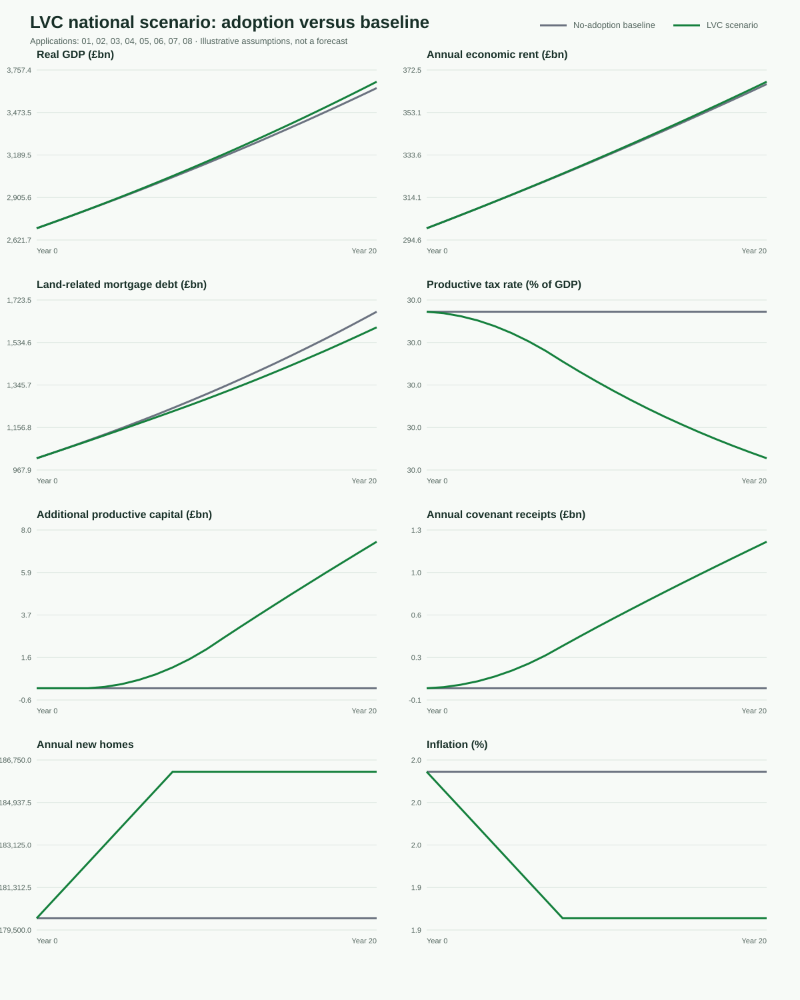
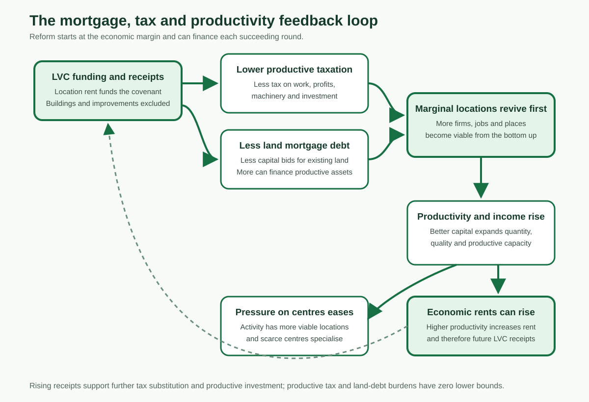

:::notice Only a model
This is an illustrative and incomplete model, presented as a demonstration of the idea ahead of real-life adoption. It is not a forecast and does not capture every effect; actual results will depend on how Location Value Covenants are designed and introduced when they happen in practice.
:::

## The question this model asks {#question}

What might change if Location Value Covenants were adopted gradually across the country?

The model compares two paths over 20 years. The **baseline** assumes that LVCs are not introduced. The **LVC path** applies all eight proposed applications, from the Location Value Mortgage to New Home Covenants, wider property investment and monetary stability.

This is a scenario tool, not an official forecast. It shows the consequences of the assumptions entered. It does not prove that those assumptions will occur.

## Three possible scenarios {#scenarios}

The scenarios deliberately range from cautious adoption to a favourable case. The average scenario is the central illustration, not a prediction.

| Assumption | Conservative | Average | Best case |
| --- | ---: | ---: | ---: |
| Eventual take-up | 10% | 25% | 50% |
| Time to reach take-up | 10 years | 8 years | 5 years |
| Annual funding capacity at full take-up | £10bn | £25bn | £50bn |
| Annual funding growth | 1% | 2% | 3% |
| Average mortgage rate | 3.5% | 4.5% | 5.5% |
| Public funding cost | 4.0% | 3.5% | 2.5% |
| Household cash-flow spent in the economy | 40% | 60% | 75% |
| Displacement of the gross GDP effect | 30% | 15% | 5% |
| Displaced mortgage credit redirected to productive investment | 10% | 20% | 35% |
| Annual output from productive capital | 6% | 10% | 15% |
| Time before investment raises output | 5 years | 3 years | 2 years |
| Receipts used to replace productive taxes | 30% | 50% | 70% |
| Output response to productive-tax reduction | 10% | 20% | 35% |
| Underlying real rental-value growth | 0.5% | 1.0% | 2.0% |
| Productivity growth reflected in rental values | 15% | 30% | 50% |

All three runs assume starting GDP of £2.7 trillion at today's prices, starting mortgage debt of £1.7 trillion, baseline real GDP growth of 1.5%, baseline mortgage-credit growth of 2.5%, inflation of 2% and 180,000 new homes a year without LVCs.

## Conservative scenario 

With slow take-up and restricted funding, the estimated effects remain modest. By year 20, GDP is £3.8bn higher than the baseline, mortgage debt is £9.3bn lower, annual new-home output is 2,500 higher and cumulative additional homes reach 38,750.

This run is useful as a test of whether the policy still makes a difference when adoption is limited and costs are relatively high.

## Average scenario 

With take-up reaching 25%, GDP is £42.6bn higher than the baseline in year 20. Mortgage debt is £69.3bn lower, annual new-home output is 6,250 higher and cumulative additional homes reach 103,125.

In year 20, the model calculates £1.94bn of mortgage interest avoided and £1.23bn of covenant payments. The resulting net household cash-flow improvement is about £0.71bn for that year, of which £0.43bn is assumed to return to the economy through household spending.

After the assumed delay and depreciation, £7.44bn remains in the model-attributed productive-capital stock. It produces an estimated £0.74bn of annual output. Approximately £0.65bn of taxes on production is replaced in year 20, producing a further estimated £0.13bn of annual output. The model associates £0.07bn of lower compensatory expenditure with those structural gains during that year. Annual economic rent is £367.16bn, slightly above the no-adoption path, while the productive-tax rate has fallen from 30% to 29.98% of GDP.

## Best-case scenario 

This is a favourable upper scenario rather than a forecast. Take-up reaches 50%, funding expands more quickly, mortgage rates are higher than the public funding cost, and little investment is assumed to be displaced.

By year 20, GDP is £332.8bn higher than the baseline, mortgage debt is £336.0bn lower, annual new-home output is 12,500 higher and cumulative additional homes reach 225,000. The estimated inflation rate is 0.15 percentage points below the baseline.

The large GDP result depends heavily on favourable assumptions. It should be read as an indication of what would have to go right, not what must happen.

## What produces the changes? 

The model works through eight main channels:

1. **Mortgage substitution.** LVC funding replaces land-related mortgage credit that would otherwise be created by commercial banks. It does not target borrowing used to construct or improve buildings.
2. **Household cash flow.** Households avoid mortgage interest but make continuing covenant payments. The difference is the estimated household cash-flow change.
3. **Spending.** A selected proportion of that household cash-flow change is assumed to be spent in the wider economy.
4. **Housing and investment.** New homes, infrastructure and regeneration create direct economic activity. The model deducts an assumed amount that might merely displace other activity.
5. **Public finances.** Covenant receipts and other associated revenue are recorded alongside the cost of funding and administering the programme.
6. **Productive investment.** A selected share of mortgage credit displaced from existing property is redirected into new productive capital. It begins adding to output only after the selected time lag and depreciates thereafter.
7. **Tax and productivity feedback.** Covenant receipts replace selected taxes on work, profits and investment. The resulting structural output reduces the need for economy-related support and raises location rental values, which can increase subsequent LVC receipts.
8. **Bottom-up development.** The national result is divided between marginal, intermediate and high-value locations. Editable response weights allow marginal locations to respond first and most strongly when productive taxation falls.

The mortgage rate therefore does not create a one-sided gain. A higher mortgage rate increases the interest households avoid, but the model separately charges the public LVC fund its own funding cost. The difference between those rates matters.

## The tax and productivity feedback loop {#feedback-loop}

LVCs are intended to create a continuing economic cycle rather than a temporary stimulus. The process begins from the bottom up, in marginal locations where taxation can turn otherwise viable work and investment into a loss. Replacing taxes on productive activity with LVC receipts allows some of these locations to become viable first, opening new opportunities quickly and giving households and businesses practical alternatives to expensive centres. This can release some of the strain created by concentrating activity in the most valuable locations, while leaving those centres available for activities that genuinely require their advantages.

At the same time, LVC funding replaces mortgage debt attributable to land value. Households continue to pay for the location through the covenant, but less capital is required to purchase the right to receive its economic rent. Finance can instead support buildings, improvements, infrastructure, equipment and other productive assets. The model therefore keeps land-related mortgage debt under close observation while deliberately excluding the value of buildings and improvements from the economic rent captured by LVCs.

Greater productive capital and lower taxes on work, profits and investment raise output and earned income. This can reduce the part of public support required to compensate for economic weakness; the model does not assume reductions in pensions, disability support, healthcare or unrelated expenditure. Higher productivity can also raise location economic rents. Even if LVCs eventually capture the whole of those rents, their annual value can continue increasing as locations become more productive. Rising receipts can finance another round of productive-tax substitution or investment, creating a potential virtuous cycle.

The model consequently follows four central trajectories together: land-related mortgage debt and productive taxation move towards theoretical lower bounds of zero, while productive capital and economic rent can continue rising. Annual LVC receipts show how much of the growing rental flow is returned to the cycle. These are policy aspirations rather than forecasts: every response remains an editable assumption, and setting a response to zero switches that part of the feedback off.

## What the results indicate {#results}

Across the three scenarios, the model indicates several possible advantages if LVCs operate as assumed:

- Lower conventional mortgage debt and less dependence on bank-created mortgage credit;
- Lower household interest costs after covenant payments are taken into account;
- More homes through the New Home Covenant;
- Additional construction, infrastructure and regeneration activity;
- A possible reduction in property-driven inflationary pressure; and
- A continuing stream of covenant receipts attached to funded properties;
- More finance directed towards productive capital rather than bidding for existing land;
- Lower taxes on marginal employment and investment; and
- Lower economy-related support expenditure as earned incomes and activity recover.

The model also identifies costs. In the average scenario, the year-20 public cash flow after funding costs, administration, productive-tax substitution and reinvestment is approximately **minus £2.79bn**. This is not the same as an economic loss: £0.65bn has been allocated to replace other taxes and £0.12bn to productive reinvestment rather than disappearing. Government would also hold long-lived covenant assets. Nevertheless, the cash requirement would have to be planned for and independently costed.

## What the model cannot tell us 

The three location bands are illustrative rather than forecasts for named regions. The calculations do not yet model property-price feedback, defaults, individual welfare programmes, detailed bank behaviour or a full response from the Bank of England. The structural and location response rates are assumptions, not estimates validated against an adopted national LVC programme.

The results are therefore best used to compare assumptions and identify the questions that a detailed Treasury or independent fiscal model would need to answer. They should not be used for personal financial decisions or quoted as guaranteed national outcomes.

## Reproducing the results {#reproduce}

The model is generated by a small, dependency-free Python program. Each run produces the annual data as CSV, the chart as SVG and a text file recording every assumption. This makes it possible for other people to inspect the calculations, change the inputs and challenge the conclusions.

The source code and three CSV datasets are available for independent inspection:

- [Download the model source code](/assets/model/lvc_national_model.py)
- [Download the conservative scenario data](/assets/model/conservative.csv)
- [Download the average scenario data](/assets/model/average.csv)
- [Download the best-case scenario data](/assets/model/best-case.csv)
