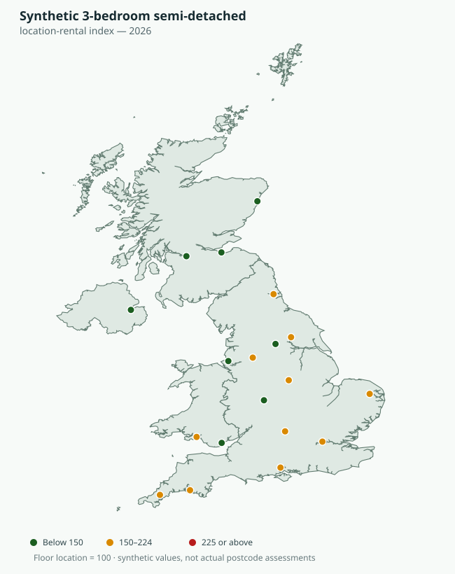
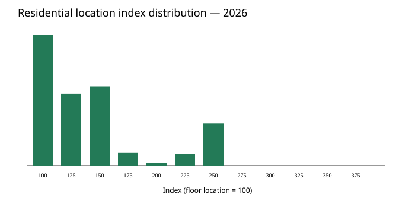

## What the register is for {#purpose}

The National Location Value Register would provide the consistent annual index needed to reassess existing Location Value Covenant payments.

It would not set the original covenant payment, value an individual plot before a covenant is created or use property selling prices. The original payment would be agreed through the transaction or policy that creates the covenant. The register would then measure how the rental value of comparable locations changes.

For a covenant in postcode **p**, comparison class **k** and year **t**:

**Reassessed payment = original payment × current index ÷ original index**

This keeps the reassessment connected to current location rental value without reopening the original agreement.

## How locations would be compared {#comparison}

The minimum published location would be the full unit postcode. Values would be expressed as annual rent per square metre so that properties of different sizes can be compared consistently.

A deliberately small number of residential comparison classes would be used:

| Characteristic | Classes |
| --- | --- |
| Property type | Flat, terraced, semi-detached, detached |
| Bedrooms | 1, 2, 3, 4 or more |
| Common measure | Annual rent per square metre |
| Minimum geography | Unit postcode |

The model compares the same kind of property in one postcode with the same kind in another. Bedrooms and property type control for the building being occupied. The remaining systematic difference in rent per square metre provides the location comparison.

This is an index of comparative location rental value. It is not a claim that every address inside a postcode is identical.

## Floor, ceiling and base location {#floor-and-ceiling}

For each comparison class, the proposed default method uses:

- the 10th percentile of estimated UK rental values as the floor;
- the 90th percentile as the ceiling;
- index 100 for the floor location; and
- every other postcode expressed relative to that floor.

A postcode's annual location-rental excess is its bounded rent per square metre minus the floor rent for the same comparison class.

This prevents a handful of unusually low or high observations from controlling the national scale. The precise percentile rules would ultimately need to be fixed in the legislation or covenant standard.

## Completing postcodes with limited evidence {#limited-evidence}

It is neither necessary nor realistic to demand perfect direct evidence for every postcode before producing a national register. The proposed system assigns one of four confidence grades:

| Grade | Description |
| --- | --- |
| A — direct | Adequate recent observations for the postcode and comparison class |
| B — modelled local | Some direct evidence, supported by neighbouring and regional evidence |
| C — spatial | No direct observation; estimated from comparable nearby postcodes |
| D — even spread | A provisional model value where usable local evidence is not presently available |

Spatial estimates use several nearby postcodes rather than copying a single neighbour. Every record identifies its evidence count, estimation method and donor postcodes.

The even-spread assumption completes the present demonstration but would remain visibly provisional. Filling a CSV cell does not turn weak evidence into a statutory fact.

## Annual assessment process {#annual-process}

A national determination would follow a fixed annual timetable:

1. Freeze the comparison basket and the postcode geography.
2. Combine the latest lawful rental and property-characteristic records.
3. Remove duplicates, bundled service charges, non-market arrangements and clear unit errors.
4. Estimate like-for-like rent per square metre for the fixed property basket.
5. Complete sparse postcodes using neighbouring and higher-level evidence.
6. Apply the published floor and ceiling.
7. Run GIS and statistical anomaly checks.
8. Submit flagged locations for council-officer review.
9. Publish the register, confidence grades, revisions and model version.
10. Apply the annual index movement to existing LVC payments.

AI and GIS would help officers find sharp boundary discontinuities, improbable annual movements, unusual property mixes, new development and local amenities or nuisances. AI would prioritise review; it would not become the legal reason for a valuation.

## Residential, commercial and rural schedules {#separate-schedules}

Commercial property requires a separate schedule because lease length, rent-free periods, repairing obligations, permitted use, access and frontage can materially affect rent.

Agriculture and forestry also require their own treatment. Their rents reflect productive capacity, soil or land grade, water, access, tenancy terms, buildings, environmental obligations and—in forestry—species and rotation age. A farm or forest can cross several postcodes.

Agricultural and forestry evidence can still be converted to annual pounds per square metre, but mapped land parcels should sit beneath the postcode publication layer. Nearby residential rent must not be used as a substitute for farm or woodland evidence.

## Published-rent prototype {#demonstration}

This prototype applies the method to 240 genuine live UK postcodes from the May 2026 ONS Postcode Directory. Its starting rent figures are real published ONS private-rent statistics, not invented rents.

There is an important limit. ONS publishes average rents by area, bedroom count and property type, but it does not publish an exact rent for a three-bedroom semi-detached home in every unit postcode. The prototype therefore estimates that missing cross-tab as **published three-bedroom rent × published semi-detached rent ÷ published all-property rent**, then assigns the applicable published area value to each sample postcode. A user-adjustable 90 m² floor-area assumption converts the result to annual rent per m².

**Every postcode result is marked estimated. The CSV keeps the three published rent inputs, source month, source geography, formula and floor-area assumption in separate columns so the estimate cannot be mistaken for an observed postcode rent.**

**What this map shows:** Each point is an estimated postcode index derived from the applicable published area rent. Green represents an index below 150, amber represents 150 to 224 and red represents 225 or above. The floor location is index 100. Postcodes sharing the same source area can have the same value; the prototype does not invent variation within that area.

The postcode centroids and the boundary use the same geographic projection. The land outline contains England, Wales, Scotland and Northern Ireland and is derived from the Office for National Statistics [Countries (December 2024) Boundaries UK BGC](https://geoportal.statistics.gov.uk/datasets/ons::countries-december-2024-boundaries-uk-bgc-2/about), generalised and clipped to the coastline.

The rent inputs are from ONS, [Price Index of Private Rents, UK: monthly price statistics](https://www.ons.gov.uk/economy/inflationandpriceindices/datasets/priceindexofprivaterentsukmonthlypricestatistics), released 19 August 2026. Great Britain figures use July 2026 data. Northern Ireland uses May 2026 because its later values were not available in that release. The prototype is evidence-led, but it remains a demonstration rather than an official assessment.

The demonstration uses confidence grade **P — published-area modelled postcode** for all 240 rows. This means the source aggregate is published but the property-class combination, floor-area conversion and postcode assignment are modelled.

- [Download the published-rent prototype register CSV](/assets/register/register-2026.csv)
- [Download the summary and confidence counts](/assets/register/summary-2026.csv)
- [Download the ONSPD postcode spine](/assets/register/postcodes-2026.csv)
- [Download the postcode evidence and provenance CSV](/assets/register/evidence-2026.csv)
- [Download the compact ONS published-rent source snapshot](/assets/register/ons-private-rents-source-2026-08.csv)
- [Read the detailed methodology](/assets/register/methodology.md)
- [Download the Python model](/assets/register/lvc-register.py)
- [Download the published-rent preparation script](/assets/register/make-published-rents-demo.py)
- [Download the UK map-generation script](/assets/register/make-register-map.py)
- [Read the model and map user guide](/assets/register/README.md)

The user guide explains the required CSV columns, how to build a new annual register, how to apply the previous year's index, and how to regenerate the map for a chosen property class and colour scale.

## What a national implementation would need {#implementation}

The register could draw on achieved-rent records used for official private-rent statistics, EPC floor area, postcode and address geography, commercial rating evidence, tenancy and lease records, agricultural rent surveys and mapped land classifications.

A future national service should synchronise these sources through a persistent property or land-parcel identifier beneath the postcode layer. Standardised machine-readable rent returns, quarterly postcode updates and a common annual snapshot date would progressively replace provisional estimates.

Each release should be reproducible, versioned and independently validated. Property owners should be able to correct factual errors and appeal the application of the published method without converting the process into a sale-price valuation of their plot.

## Relationship to LVC applications {#relationship}

The register is shared infrastructure rather than another application of the covenant. The same annual index could support Location Value Mortgages, mortgage rescue, homeowner pensions, inheritance-tax settlement, farming arrangements, new homes and other applications while preserving the terms of each individual covenant.

The covenant creates the payment. The register provides the consistent annual measure by which that payment changes.
